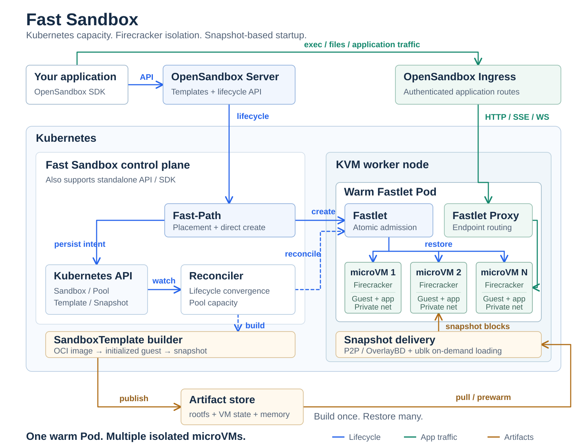

# Fast Sandbox

**构建在 Kubernetes 之上的高性能 Sandbox 运行时，基于 Firecracker microVM。**

[English](README.md) · [通过 OpenSandbox 使用](#通过-opensandbox-使用推荐) · [独立部署](#独立部署) · [完整文档](docs/README.md) · [架构](docs/concepts/architecture.md)

Fast Sandbox 将 Firecracker microVM 的虚拟机隔离与快照启动能力带到 Kubernetes，
面向需要频繁创建和回收执行环境的场景：AI Agent、代码解释器，以及按需开发和测试沙箱。

Kubernetes 管理资源容量和生命周期期望状态。预热的 **Fastlet Pod** 承载多个 Sandbox，
Firecracker 运行时从预先构建的快照恢复每个实例。创建 Sandbox 时直接复用已有容量，
无需为每次请求重新调度和启动一个 Kubernetes Pod。

推荐通过 [OpenSandbox](https://github.com/opensandbox-group/OpenSandbox) 使用，
它已经集成 Fast Sandbox，提供 API、SDK、入口网关和命令执行能力。也可以独立部署
Fast Sandbox，作为你自己的平台的 Sandbox 调度与运行时层。



## 核心能力

- **Firecracker microVM 隔离**：每个 Firecracker Sandbox 拥有独立的 microVM、
  客体内核、私有网络命名空间和实例 rootfs。
- **从快照快速启动**：构建并初始化一次环境，随后从保存的虚拟机和内存状态恢复新实例。
  通过 XFS reflink 克隆 rootfs，避免在创建路径中复制整个磁盘文件。
- **预热池与高密度部署**：SandboxPool 维护就绪的 Fastlet Pod，每个 Fastlet 在配置的
  资源和容量限制内接纳多个实例。
- **专门的快速创建路径**：多活 Fast-Path 持久化 Sandbox 意图、选择就绪 Fastlet
  并直接调用。Fastlet 负责原子容量准入，Kubernetes Reconcile 负责生命周期收敛。
- **共享快照分发与按需加载**：节点 runtime-agent 为本节点 Fastlet 缓存快照产物，
  P2P 分发减少重复回源。基于 OverlayBD + ublk 的 `fsb-vm` 路径按需读取 rootfs 和内存快照的
  数据块，无需在启动前下载全部产物。
- **状态保存与复用**：暂停实例以释放容量，随后在兼容的 Fastlet 上恢复；也可以把运行中
  的 Sandbox 发布为可重复使用的镜像。
- **Kubernetes 原生运维**：通过 CRD 管理 Sandbox、Pool、模板和快照，支持声明式
  生命周期管理和状态观测。

[工作原理](docs/concepts/architecture.md)

## 通过 OpenSandbox 使用（推荐）

[OpenSandbox](https://github.com/opensandbox-group/OpenSandbox) 已经集成 Fast Sandbox。
通过它的 API 和 SDK，可以构建模板、创建 microVM Sandbox、执行命令、操作文件，以及
管理暂停恢复和快照。Fast Sandbox 负责 Pool 调度、预热容量和 Firecracker 生命周期，
OpenSandbox 提供面向应用的接口和带鉴权的入口网关。

```text
你的应用 -> OpenSandbox API / SDK
                  -> Fast Sandbox -> Fastlet -> Firecracker microVM
```

完整开发环境从最新 OpenSandbox 代码搭建。准备一台裸金属 Linux 主机，需要 KVM、Docker、
Go ≥ 1.25、cgroup v2 和 sudo，并安装 `uv` 用于 CLI 和 SDK 验证。脚本会准备 Kind 集群、
对象存储、golden image、运行时、Server 和入口网关，并验证 Sandbox 创建和访问。
首次搭建包含镜像构建和下载。

```bash
git clone https://github.com/opensandbox-group/OpenSandbox.git
cd OpenSandbox

WARM_IMAGES=1 ./scripts/fast-sandbox-env/integration-env.sh up
./scripts/fast-sandbox-env/integration-env.sh status
./scripts/fast-sandbox-env/integration-env.sh sdk-e2e
```

生命周期 API 地址为 `http://127.0.0.1:18080`，环境的 API Key 为 `fast-sandbox-env`。
从 OpenSandbox 模板列表中选择构建状态为 `Succeeded` 的模板，然后通过 Python SDK 使用：

```python
import asyncio
from datetime import timedelta

from opensandbox.config import ConnectionConfig
from opensandbox.sandbox import Sandbox


async def main():
    sandbox = await Sandbox.create_from_template(
        "tpl_<succeeded-template-id>",
        timeout=timedelta(minutes=10),
        ready_timeout=timedelta(minutes=5),
        connection_config=ConnectionConfig(
            domain="127.0.0.1:18080",
            protocol="http",
            api_key="fast-sandbox-env",
        ),
    )
    try:
        result = await sandbox.commands.run("echo hello-firecracker")
        for message in result.logs.stdout:
            print(message.text)
    finally:
        await sandbox.destroy()


asyncio.run(main())
```

当前 OpenSandbox Server 在 `runtime.type = "kubernetes"` 下集成 Fast Sandbox。
携带 `templateId` 的模板创建请求会选择 Fast Sandbox 后端，对应 Python SDK 的
`Sandbox.create_from_template()`。集成环境会自动配置这条链路，并使用 OpenSandbox
锁定的 Fast Sandbox 版本构建运行时。

详见 [OpenSandbox 集成环境](https://github.com/opensandbox-group/OpenSandbox/tree/main/scripts/fast-sandbox-env)、
[Helm 部署指南](https://github.com/opensandbox-group/OpenSandbox/blob/main/manifests/HELM-DEPLOYMENT.md#fast-sandbox-runtime-firecracker) 和
[Python SDK](https://github.com/opensandbox-group/OpenSandbox/tree/main/sdks/sandbox/python)。
体验完成后，在 OpenSandbox 目录执行
`./scripts/fast-sandbox-env/integration-env.sh down` 清理开发环境。

## 独立部署

如果你的平台已经有 Sandbox API，或者需要自己的应用协议，可以独立部署 Fast Sandbox，
作为 Sandbox 调度与运行时层。通过 Fast-Path gRPC API、Fast Sandbox SDK 或 Kubernetes
CRD 接入，复用 Pool 调度、原子容量准入、microVM 创建、端点解析和资源清理能力。

```text
你的 Sandbox API -> Fast-Path / Kubernetes CRD -> Fastlet -> Firecracker microVM
```

在本仓库中运行独立 Firecracker 开发环境，需要 Linux、KVM、`/dev/net/tun`、Docker、
root 或 sudo，以及足够的磁盘空间。脚本会准备双节点 Kind 集群、XFS reflink 状态存储、
MinIO、runtime-agent、golden image 和 Firecracker Pool：

```bash
# 预热快照产物，并保留现有 Docker data-root 配置。
DOCKER_DATA_ROOT= WARM_IMAGES=1 ./scripts/integration-env.sh up

# 创建 Sandbox，经路由验证 execd /ping，然后删除测试实例。
./scripts/integration-env.sh verify
./scripts/integration-env.sh status
./scripts/integration-env.sh down
```

详见 [独立部署](docs/guides/deployment.md)、
[Firecracker 环境搭建](docs/guides/firecracker-integration-env.md) 和
[API 参考](docs/reference/api.md)。如果希望通过 container 运行时体验控制面，可使用
`make quickstart`，并参考 [Quick Start](docs/getting-started/quickstart.md)。

## 性能

Fast Sandbox 通过复用就绪 Fastlet、预先准备网络槽位、缓存快照产物、reflink 克隆 rootfs，
以及恢复已初始化的 microVM，降低创建延迟。

[OpenSandbox ACK 性能报告](https://github.com/opensandbox-group/OpenSandbox/blob/main/docs/architecture/fast-sandbox/performance.md)
在 2026-10-08 测量了完整 Python SDK 创建链路：从 `Sandbox.create_from_template()`
发起请求，经过生命周期 Server、FastPath、入口网关，直到客体首次 `/ping` 成功：

| 预热 SDK 创建 | 成功数 | p50 | p99 | 均值 |
| --- | ---: | ---: | ---: | ---: |
| 串行复测 | 100/100 | 77.9 ms | 112.5 ms | 78.2 ms |
| 并发 10 | 100/100 | 102.7 ms | 125.4 ms | 102.4 ms |

测试使用双节点 ACK KVM 环境、AMD EPYC 9T95 CPU、Firecracker 1.16.1、XFS reflink
存储、已缓存的 Alpine + Execd 模板（1 vCPU / 2 GiB 内存）和 20 个预热槽位。
SDK 就绪轮询间隔为 10 ms，默认值为 200 ms；单次延迟不包含删除和批次回收等待。

这些是有明确日期的工程测量，不是生产 SLA，也不是对当前最新代码的重新测量。
并发 20 的测试仅成功 51/100 次，报告记录了容量拒绝和一次就绪超时，因此不能据此推导
持续吞吐能力。首次产物下载是另一项成本。环境、版本、失败情况和运行时分段数据见
[原始样本](https://github.com/opensandbox-group/OpenSandbox/blob/main/docs/public/benchmarks/fast-sandbox-ack-2026-10-08.json)。

Fast Sandbox API 的 Create 默认等待聚合 `Ready`；显式选择 `RuntimeReady` 可以提前
返回，不等待组件和路由就绪。基准测试需要注明完成边界和缓存状态，测量工具见
[性能指南](docs/guides/performance.md)。

## 应用协议

应用在客体内暴露自己的协议，HTTP、SSE 和 WebSocket 流量可通过带鉴权的代理访问。
可选的 [Infra Component](docs/concepts/infra-components.md) 提供受管理的进程、健康检查
和命名端点。OpenSandbox Execd 可以在构建阶段写入 Firecracker 模板，提供命令执行和
文件操作能力。

## 运行时选择与当前范围

直接运行的 `firecracker` 是本文介绍的快照恢复路径。Fast Sandbox 同时支持通过
containerd 运行 `container`、`gvisor`、`kata-qemu`、`kata-clh`、`kata-fc` 和
`kata-dragonball`。其中 `kata-fc` 使用 Kata 的 Firecracker 集成，启动路径与
`firecracker` 不同。具体配置见 [运行时模型](docs/concepts/runtimes.md) 和
[运行时支持](docs/reference/runtime-support.md)。

OverlayBD 按需加载当前通过主机侧的 [`fsb-vm` 路径](docs/guides/fsb-vm-user-guide.en.md)
提供；OpenSandbox/Kubernetes 集成使用完整缓存的 native 快照产物。

- 当前 CRD 和 Fast-Path API 版本为 `v1alpha2`，仍处于 alpha 阶段。
- Firecracker 需要兼容的 KVM 主机和快照产物；直接运行时需要支持 reflink 的 XFS
  状态目录。
- Firecracker Sandbox 使用已发布的快照产物；OCI 镜像需要先通过 `SandboxTemplate`
  构建，再用于该运行时。
- 暂停恢复和运行中快照由 Firecracker 运行时实现；跨主机恢复要求主机满足快照兼容条件。
- Fastlet Pod 丢失会销毁其中的运行实例，自动重建会创建新一代实例。当前范围不包含
  持久化存储和热迁移。

## 文档

- [文档索引](docs/README.md)
- [Firecracker 部署与验证](docs/guides/firecracker-integration-env.md)
- [Golden image 构建](docs/guides/sandboxtemplate-golden-images.md)
- [运行中快照](docs/guides/sandbox-snapshots.md)
- [暂停与恢复](docs/guides/pause-resume-snapshot-integration.md)
- [快照 CPU 兼容性](docs/guides/snapshot-cpu-compatibility.md)
- [私有网络](docs/concepts/networking.md)
- [部署指南](docs/guides/deployment.md)
- [可观测性](docs/guides/observability.md)
- [API 参考](docs/reference/api.md) · [CLI 参考](docs/reference/fastctl.md)

## 许可证

[Apache-2.0](LICENSE)
