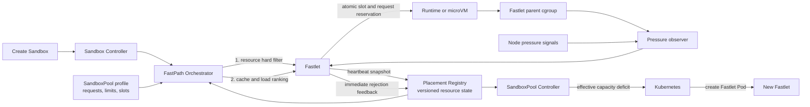

# Resource-Aware Overcommit Placement

> Document type: Architecture design proposal
>
> Tracking issue: [#115 — Guide placement with CPU and memory budgets and pressure, not only slots](https://github.com/opensandbox-group/fast-sandbox/issues/115)
>
> Related work: [#102 — Fastlet memory reclamation and pressure-aware admission](https://github.com/opensandbox-group/fast-sandbox/issues/102), [PR #114 — free-page reporting and pressure admission](https://github.com/opensandbox-group/fast-sandbox/pull/114)
>
> Status: Implemented behind independent controller feature switches
>
> Last updated: 2026-10-18

## Summary

Fast Sandbox currently uses `maxSandboxesPerPod` as both an instance-count
boundary and the primary placement capacity signal. This is correct for
limiting the number of runtime actors, but a slot has no stable CPU or memory
meaning across SandboxPools. A free slot therefore does not prove that a
Fastlet has enough resource commitment or live memory headroom for another
Sandbox.

This proposal keeps slot admission and adds two independent scheduling
dimensions:

1. a static CPU and memory commitment ledger based on per-Sandbox requests;
2. a dynamic pressure gate based on Fastlet and node observations.

Each SandboxPool declares one immutable resource profile with requests and
limits. In `ResourceAware` mode, the Controller is the only component that
derives the per-Fastlet commitment capacity and runtime-owner envelope. The
first container's CPU and memory resources are not a second capacity input.
The Controller always emits an equal Kubernetes request and limit:

```text
runtimeOwner.requests == runtimeOwner.limits == runtimeEnvelope
```

Individual Sandboxes may still have `limit > request`. They can borrow unused
capacity from siblings, while the Fastlet parent cgroup keeps aggregate use
bounded. Operators control overcommit only through the per-Sandbox request and
limit gap. `LegacySlot` Pools retain their existing explicit Fastlet aggregate
request and limit behavior.

FastPath uses reported resource state to avoid candidates that are already
known to be full or pressured. Fastlet remains the final authority and checks
slot, commitment, pressure, identity, and lifecycle state atomically before
performing side effects. SandboxPool scaling uses effective schedulable
capacity instead of counting Fastlet Pods alone.

## Context and problem statement

### Current model

One SandboxPool fixes a runtime, one per-Sandbox CPU/memory/PID limit profile,
`maxSandboxesPerPod`, and a Fastlet Pod template. The Pool Controller creates
warm Fastlet Pods, and each Fastlet can host up to the configured slot count.

Placement currently follows this model:

1. filter candidates by identity, profile compatibility, readiness,
   heartbeat freshness, drain state, and free slots;
2. rank eligible candidates by image-cache affinity and slot load;
3. call Fastlet Create;
4. rely on Fastlet's local atomic admission for correctness.

In the legacy model, the runtime-owner container request and limit provide an
aggregate Kubernetes resource envelope. Operators can configure an aggregate envelope lower than
the sum of all per-Sandbox limits, which already enables a basic overcommit
model. However, neither FastPath nor the slot ledger understands the CPU and
memory meaning of that configuration.

### Why slots are insufficient

A slot is an actor-count unit, not a resource unit. Consider two Pools:

```text
Pool A: 1 CPU, 1 GiB per Sandbox
Pool B: 4 CPU, 10 GiB per Sandbox
```

One free slot in Pool A and one free slot in Pool B represent very different
resource demands. The mismatch becomes more important when multiple Fastlets
or Pools share a Kubernetes node.

The current model also cannot distinguish these states:

- ten slots exist and the commitment budget can admit ten Sandboxes;
- ten slots exist but the configured commitment budget can admit only eight;
- a commitment entry is available but the Fastlet cgroup is under memory
  pressure because admitted Sandboxes are using above their requests;
- the Fastlet cgroup is healthy but its Kubernetes node is under memory
  pressure;
- the latest heartbeat looks healthy but a newer Create response has already
  reported a local pressure rejection.

Treating all of these cases as “a slot is available” causes repeated failed
placement, hides real Pool capacity shortages, and delays scale-out.

### Relationship to memory reclamation

Issue #102 and PR #114 establish a Fastlet-local observe, reclaim, measure,
admit-or-reject, and recover loop. That loop protects the local runtime even
when FastPath has stale state.

This proposal propagates the resulting admission state to FastPath and the
Pool Controller. Reclaimed bytes and temporarily free memory are observations;
they never increase the configured commitment budget and never cause an
automatic increase in the overcommit ratio.

## Goals

- Preserve `maxSandboxesPerPod` as an independent hard instance-count limit.
- Add explicit per-Sandbox CPU and memory requests while preserving hard
  per-Sandbox limits.
- Define one authoritative Fastlet commitment capacity without double
  accounting Kubernetes Pod resources and inner Sandbox commitments.
- Make FastPath reject stale, unsupported, resource-full, and pressured
  candidates before cache-affinity ranking.
- Keep Fastlet atomic local admission as the correctness boundary.
- Propagate local rejections quickly enough to avoid repeatedly selecting a
  known-bad candidate.
- Define ordering rules so an older healthy heartbeat cannot clear a newer
  pressure rejection.
- Distinguish Fastlet-scoped constraints from node-scoped constraints.
- Make Pool scaling respond to effective schedulable capacity rather than Pod
  count or slot count alone.
- Support mixed-version rollout with explicit legacy and unsupported states.
- Start with dynamic memory pressure and leave a compatible extension point
  for dynamic CPU pressure.

## Non-goals

- Automatically changing requests, limits, or the overcommit ratio from live
  utilization.
- Automatically pausing, waking, migrating, evicting, or preempting running
  Sandboxes.
- Treating swap as allocatable memory or managing guest swap.
- Introducing heterogeneous Sandbox resource profiles inside one Fastlet.
- Adding a separate `resourceCommitmentLimit` API that competes with the
  Controller-derived commitment capacity.
- Adding a user-visible Fastlet overhead field or per-Sandbox overhead field.
- Building a node-wide numeric reservation ledger in FastPath.
- Replacing Kubernetes scheduling or Cluster Autoscaler behavior.

## Terminology and invariants

| Term | Meaning | Authority |
| --- | --- | --- |
| Slot capacity | Maximum number of Sandbox lifecycle entries that may occupy a Fastlet | `maxSandboxesPerPod`, enforced by Fastlet |
| Sandbox request | CPU or memory charged to the Fastlet commitment ledger | Immutable SandboxPool resource profile |
| Sandbox limit | Per-Sandbox runtime isolation ceiling | RuntimeDriver and child cgroup or VM configuration |
| Commitment capacity | Aggregate capacity available only to inner Sandbox commitments | Controller-derived `Sandbox request * maxSandboxesPerPod` |
| Runtime envelope | Runtime-owner Kubernetes request and parent-cgroup ceiling | Fixed runtime overhead plus the larger of commitment capacity and one Sandbox limit |
| Committed resource | Sum of requests for lifecycle entries that may still own runtime resources | Fastlet local ledger |
| Observed usage | Current cgroup or runtime consumption | Fastlet observer |
| Pressure state | Admission consequence derived from cgroup and node signals | Fastlet local admission controller |
| Effective free capacity | Number of additional Sandboxes admissible across slots, commitments, and pressure | Derived by FastPath and Pool Controller |

The design has the following invariants:

1. `Sandbox request <= Sandbox limit` for CPU and memory.
2. `runtimeOwner.request == runtimeOwner.limit == runtimeEnvelope` in resource-aware mode.
3. `sum(admitted Sandbox requests) <= commitmentCapacity` in resource-aware mode.
4. A Sandbox occupies a slot and its full request from accepted Create until
   resource absence is proven.
5. Observed usage never changes configured capacity or committed requests.
6. `BLOCKED`, `UNKNOWN`, and stale resource state are not eligible for new
   resource-aware placement.
7. FastPath observations are advisory; Fastlet admission is authoritative.
8. A rejection permits reassignment only when it is proven to have occurred
   before side effects.

## Architecture



The request path and feedback loop have separate responsibilities:

- SandboxPool owns immutable demand and isolation policy.
- FastPath chooses only among candidates that appear admissible.
- Fastlet serializes the final admission decision with lifecycle identity.
- RuntimeDriver enforces per-Sandbox limits.
- The Fastlet parent cgroup enforces the aggregate runtime limit.
- The observer converts raw usage and pressure signals into an admission state.
- Registry caches versioned observations but never owns reservations.
- Pool Controller replaces lost effective capacity by creating Fastlet Pods.
- Kubernetes remains the authority for placing Fastlet Pods on nodes.

## Resource API

### Proposed SandboxPool shape

```yaml
apiVersion: sandbox.opensandbox.io/v1alpha2
kind: SandboxPool
metadata:
  name: memory-overcommit-example
spec:
  maxSandboxesPerPod: 10

  sandboxResources:
    requests:
      cpu: 250m
      memory: 4Gi
    limits:
      cpu: "2"
      memory: 5Gi
    pids: 256

  fastletTemplate:
    spec:
      containers:
        - name: fastlet
          image: fast-sandbox/fastlet:dev
```

The example permits at most ten actor slots. Each admitted Sandbox commits
250 millicores and 4 GiB, and may use up to 2 CPUs and 5 GiB. Its CPU
overcommit ratio is 8:1, while its memory overcommit ratio is only 1.25:1.

### Field semantics

`sandboxResources.requests` defines admission demand. Fastlet charges the full
request at admission time and does not change the charge based on utilization.

`sandboxResources.limits` defines the per-Sandbox runtime ceiling. Limits are
passed to the RuntimeDriver and enforced by the child cgroup, VMM, or equivalent
runtime boundary.

`sandboxResources.pids` remains a per-Sandbox limit. This proposal does not
introduce PID requests or PID overcommit.

`maxSandboxesPerPod` remains an absolute count boundary for Sandbox actors,
network namespaces, runtime state, file descriptors, and control-plane state.
It is enforced even when CPU and memory remain available.

The Controller derives two distinct quantities. They must not be added or
re-derived by Fastlet, FastPath, or the Pool scaler:

```text
commitmentCapacity.cpu
  = sandboxResources.requests.cpu * maxSandboxesPerPod

commitmentCapacity.memory
  = sandboxResources.requests.memory * maxSandboxesPerPod

runtimeEnvelope.cpu
  = fixedFastletOverhead.cpu
  + max(commitmentCapacity.cpu, sandboxResources.limits.cpu)

runtimeEnvelope.memory
  = fixedFastletOverhead.memory
  + max(commitmentCapacity.memory, sandboxResources.limits.memory)

runtimeOwner.requests = runtimeEnvelope
runtimeOwner.limits   = runtimeEnvelope
```

`commitmentCapacity` excludes fixed overhead because it represents only the
ledger that can be allocated to Sandboxes. `runtimeEnvelope` includes the
runtime profile's fixed Fastlet overhead exactly once. Taking the maximum with
one Sandbox limit ensures that the parent cgroup can honor one legal burst.
Sidecar requests and limits remain independent Kubernetes resources and do not
enter either formula.

### Defaults

For the example above, assume the selected runtime profile has fixed overhead
of 250m CPU and 256 MiB memory:

```text
commitmentCapacity.cpu
  = 250m * 10 = 2500m

commitmentCapacity.memory
  = 4Gi * 10 = 40Gi

runtimeEnvelope.cpu
  = 250m + max(2500m, 2) = 2750m

runtimeEnvelope.memory
  = 256Mi + max(40Gi, 5Gi) = 40Gi + 256Mi

runtimeOwner.requests = runtimeOwner.limits = runtimeEnvelope
```

The fixed overhead comes from the platform-owned runtime profile for
containerd, gVisor, Kata, or Firecracker. It is not configurable in the
SandboxPool and is never multiplied by `maxSandboxesPerPod`.

### Capacity delivery to Fastlet

A Kubernetes request is a scheduling reservation, not a portable cgroup value
that Fastlet can reliably rediscover from the runtime hierarchy. The Pool
Controller therefore compiles one resolved contract and projects it to every
consumer. It writes the commitment capacity and runtime envelope into
immutable Fastlet settings, writes the same commitment capacity into a
platform-owned Pod annotation for FastPath and Pool scaling, and sets the
runtime-owner Kubernetes request and limit to the runtime envelope.

The projected resource-admission settings contain:

```yaml
version: v1
mode: ResourceAware
staticAdmission: true
memoryAdmission: true
capacity:
  cpu: 2500m
  memory: 40Gi
runtimeLimit:
  cpu: 2750m
  memory: 41216Mi
resourceProfileHash: sha256:...
```

Fastlet uses `capacity` as its commitment ledger boundary. It independently
observes the effective parent-cgroup limit and compares it with the projected
runtime limit. A mismatch, missing projection, or unbounded parent in a
ResourceAware Pool produces `UNKNOWN` and blocks new admission.

FastPath and the Pool scaler decode the Controller-owned commitment annotation;
they never infer commitment capacity from the first container's request.

The settings revision is content-addressed and participates in the Fastlet Pod
template hash. Capacity changes therefore roll Fastlet Pods rather than
changing the meaning of a running ledger in place.

### Validation

Admission or Pool reconciliation must reject a resource-aware profile when:

- a CPU or memory request is absent, zero, or negative;
- a CPU or memory limit is absent, zero, or negative;
- a Sandbox request exceeds its corresponding Sandbox limit;
- the first Fastlet container explicitly sets CPU or memory requests or limits;
- old flat resource fields and new nested fields are mixed;
- the selected RuntimeDriver cannot enforce the requested limit profile.

Explicit resources on sidecars remain valid. Existing `LegacySlot` Pools may
also keep explicit aggregate CPU and memory resources on the first container.

### Resource profile identity

The immutable resource profile hash must include:

- CPU request and limit;
- memory request and limit;
- PID limit;
- a schema/version discriminator.

Fastlet rejects a Create whose resource profile hash differs from its prepared
Pool profile. A caller cannot submit a smaller request to bypass the ledger or
a larger limit to bypass Pool isolation.

### Public Pool discovery

`GetPool` and `ListPools` continue to expose the legacy flat resource fields
for compatibility and add one structured resource profile at field 17:

```proto
enum SandboxResourceMode {
  SANDBOX_RESOURCE_MODE_UNSPECIFIED = 0;
  SANDBOX_RESOURCE_MODE_LEGACY_SLOT = 1;
  SANDBOX_RESOURCE_MODE_RESOURCE_AWARE = 2;
}

message ComputeResourceProfile {
  string cpu = 1;
  string memory = 2;
}

message SandboxResourceProfileInfo {
  SandboxResourceMode mode = 1;
  ComputeResourceProfile requests = 2;
  ComputeResourceProfile limits = 3;
  int64 pids = 4;
}

message PoolInfo {
  // Existing fields 1 through 16 remain unchanged.
  SandboxResourceProfileInfo sandbox_resource_profile = 17;
}
```

For a `LegacySlot` Pool, `requests` is absent and `limits` mirrors the existing
flat CPU and memory fields. For a `ResourceAware` Pool, both `requests` and
`limits` are populated, while the existing flat CPU and memory fields continue
to return the limit values for older clients.

This phase does not add dynamic capacity or Fastlet health summaries to the
public `PoolInfo` contract. Effective free capacity and blocked or unknown
Fastlet counts remain internal Registry, controller, heartbeat, and metrics
data until their aggregation, freshness, and external consumers are defined.

### FastPath-to-Fastlet Create request

The HTTP request carries only caller-owned desired state. The nested
`SandboxDesiredSpec` contains image, runtime and resource profile hashes,
Infra revision, command, arguments, environment, working directory, and an
optional restore descriptor. It has no CPU, memory, or PID fields.

After identity, profile, and admission validation succeeds, Fastlet creates a
separate runtime-only object:

```go
type RuntimeSandboxConfig struct {
    Identity SandboxIdentity
    Desired  SandboxDesiredSpec
    Limits   SandboxRuntimeLimits
}
```

`SandboxRuntimeLimits` is resolved exclusively from the immutable resource
profile mounted into Fastlet. RuntimeDriver implementations consume this
resolved object and never read resource values from the caller's HTTP request.
Requests remain in the resource profile and are used only by admission,
placement, and scaling. Runtime requests are intentionally absent because the
system does not yet configure CPU weight, `memory.low`, per-Sandbox priority,
or another per-Sandbox QoS mechanism.

For in-place Fastlet upgrades, the runtime-state decoder accepts the previous
persisted `config.spec` shape and separates its desired fields and limits while
loading. New state is always written as `config.desired` plus `config.limits`.
This narrow persistence migration is not an HTTP resource-field adapter.

## Fastlet commitment ledger

### Canonical capacity and demand

Fastlet loads the Controller-resolved commitment capacity and runtime envelope
from immutable settings. It combines those values with the immutable Pool
profile loaded during startup.

For each resource:

```text
capacity(resource)  = Controller-derived commitment capacity
committed(resource) = sum(request(resource) for all occupying Sandboxes)
available(resource) = max(0, capacity(resource) - committed(resource))
```

`available` is derived rather than stored as an independent authority.

### Lifecycle accounting

| Sandbox state | Occupies slot | Commits request | Reason |
| --- | ---: | ---: | --- |
| Create reserved or creating | Yes | Yes | Side effects may begin after reservation |
| Running | Yes | Yes | Runtime owns resources |
| Deleting | Yes | Yes | Runtime may still own resources |
| Delete failed | Yes | Yes | Absence is not proven |
| Create cleanup in progress | Yes | Yes | Partial resources may remain |
| Create cleanup failed | Yes | Yes | Resource ownership is unknown |
| Terminal create failure after proven cleanup | No | No | No runtime resources remain |
| Fully deleted | No | No | Absence is proven |

Slot and commitment changes occur in the same Fastlet admission critical
section. There is no state in which a Create owns resource commitment without
an identity entry or occupies a slot without its resource commitment.

### Atomic admission

The authoritative pre-side-effect check is equivalent to:

```text
canAdmit =
    identity permits a new generation
    and Fastlet is not recovering or draining
    and runtime and infrastructure are ready
    and slotUsed < slotCapacity
    and committedCPU + requestCPU <= capacityCPU
    and committedMemory + requestMemory <= capacityMemory
    and aggregateAdmissionState not in {BLOCKED, UNKNOWN}
    and runtime-local network resources are available
```

If every check passes, Fastlet creates one durable in-memory reservation that
contains the identity, lifecycle phase, slot ownership, and resource request.
Only then may runtime, network, Infra, route, or action side effects begin.

### Idempotency and concurrency

An idempotent replay of an existing identity returns the existing state and
never charges its request twice. Concurrent Creates are serialized by the same
boundary used for current slot admission. FastPath replicas may race and choose
the same Fastlet, but only the requests that pass this boundary become
committed.

### Recovery

Fastlet starts in `UNKNOWN` and rejects new Creates while reconstructing local
state. It rebuilds the ledger from durable metadata and runtime inventory,
including deleting and cleanup-failed entries. Admission becomes eligible only
after recovery and the first complete resource observation both succeed.

If recovery cannot prove that a runtime resource is absent, the corresponding
request remains committed. Conservative over-accounting is recoverable;
optimistic release can exceed the physical boundary.

## Resource admission status

### Heartbeat schema

The existing slot `AdmissionStatus` remains present. Because one Fastlet has
one immutable Pool resource profile, FastPath can derive static commitment as
`admission.used * sandbox request` and read capacity from the Controller-owned
Pod annotation. The heartbeat therefore adds only the dynamic
admission decision and the ordering needed to reconcile it with immediate
Create feedback:

```yaml
admission:
  capacity: 12
  creating: 1
  running: 8
  deleting: 0
  used: 9

  resources:
    version: v1
    epoch: 7f2c8f95-6db5-48c3-8c77-b4d8e9bb47c0
    revision: 108
    state: OPEN
```

The corresponding protocol type is intentionally small:

```go
type ResourceAdmissionStatus struct {
    Version  string          `json:"version"`
    Epoch    string          `json:"epoch"`
    Revision uint64          `json:"revision"`
    State    AdmissionState  `json:"state"`
    Reason   AdmissionReason `json:"reason,omitempty"`
}
```

`reason` is present only when it explains the selected non-`OPEN` state. Its
bounded enum identifies the resource and whether the cause is Fastlet- or
node-scoped, so separate `scope` and `resource` fields are unnecessary. Fastlet
may retain multiple raw conditions internally for local metrics and logs, but
FastPath needs only the aggregate decision and its dominant reason.

The heartbeat does not repeat `mode`, capacity, commitment, runtime limit,
observed usage, or a Fastlet timestamp. Mode and static quantities already
come from the Pool and watched Pod, observed usage remains a Fastlet-local
metric, and Registry uses its own receive time for freshness.

### States

| State | Placement behavior | Meaning |
| --- | --- | --- |
| `OPEN` | Eligible if all static checks pass | Observation is fresh and no blocking pressure exists |
| `DEGRADED` | Eligible but ranked after `OPEN` candidates | Capacity exists but a soft pressure or CPU saturation signal is active |
| `BLOCKED` | Ineligible | Local or node policy rejects new admission |
| `UNKNOWN` | Ineligible for a resource-aware Pool | Telemetry is missing, stale, recovering, unsupported, or incomplete |

The aggregate state is the most restrictive relevant condition. A node-scoped
memory block therefore blocks every Fastlet on that node even when an
individual Fastlet cgroup is below its local threshold.

### Reasons

Reason values are stable machine-readable identifiers. The initial set should
include:

```text
STATIC_CPU_EXHAUSTED
STATIC_MEMORY_EXHAUSTED
FASTLET_MEMORY_HIGH_WATERMARK
FASTLET_MEMORY_PSI
FASTLET_OOM_EVENT
NODE_MEMORY_PRESSURE
CPU_SATURATION
CPU_THROTTLING
TELEMETRY_STALE
TELEMETRY_MISSING
RECOVERY_INCOMPLETE
UNSUPPORTED_PROTOCOL
```

Reasons explain a state but do not replace it. Metrics and logs use bounded
reason labels and must not include Sandbox IDs or unbounded error strings.

### Epoch, revision, and freshness

`epoch` identifies one Fastlet process incarnation. `revision` is monotonic
within the epoch and increments whenever the slot or commitment ledger, state,
or selected reason changes. It versions the complete `AdmissionStatus`, not
only the nested resource fields.

Registry accepts a snapshot only when:

1. the Fastlet Pod UID matches the registered Pod;
2. the protocol version is supported;
3. the epoch matches the accepted incarnation and the revision is newer; or
4. a new epoch supplies a complete initial snapshot after reconnect/recovery.

Registry records its local receive time and uses that time for heartbeat
staleness, avoiding dependence on Fastlet clock synchronization.

### Immediate rejection feedback

A pre-side-effect resource rejection returns the resource snapshot that made
the decision:

```yaml
disposition: REJECTED_BEFORE_SIDE_EFFECTS
error:
  code: CAPACITY_REJECTED
  reason: FASTLET_MEMORY_HIGH_WATERMARK
  retryable: true
admission:
  resources:
    version: v1
    epoch: 7f2c8f95-6db5-48c3-8c77-b4d8e9bb47c0
    revision: 109
    state: BLOCKED
    reason: FASTLET_MEMORY_HIGH_WATERMARK
```

Registry applies this response immediately and records a rejection fence at
`(Pod UID, epoch, revision)`. An older healthy heartbeat cannot clear the
fence. Only a newer complete `OPEN` snapshot in the same epoch, or a valid full
snapshot from a new epoch, can restore eligibility.

Transport ambiguity does not create feedback that authorizes reassignment.
FastPath retries the same identity and assignment unless it receives an
explicit `REJECTED_BEFORE_SIDE_EFFECTS` disposition.

### Multiple FastPath replicas

Every FastPath replica may maintain a local Registry. Correctness does not
require synchronous Registry convergence because Fastlet performs the final
atomic check.

For efficiency, heartbeat updates and immediate rejection observations should
be published through the existing control-plane observation path so all
replicas converge on the same `(Pod UID, epoch, revision)` state. This channel
is not a reservation service and does not require a distributed lock.

If a replica misses the immediate event, it may select the stale candidate
once. Fastlet rejects the request safely, and the response updates that
replica. Metrics must expose replication or observation lag so repeated stale
selection is visible.

## FastPath placement

### Candidate demand

FastPath resolves CPU and memory demand from the immutable SandboxPool profile
selected for the request. It does not trust resource values supplied by the
caller and does not allow per-request overrides inside one Pool.

### Hard-filter order

The candidate pipeline becomes:

1. namespace, Pool, and Pod UID match;
2. Pod, runtime, and Infra readiness;
3. runtime, resource, Infra, Fastlet, and Registry revisions;
4. heartbeat and resource-observation freshness;
5. not draining and not under a rejection fence;
6. free slot available;
7. CPU commitment can fit the Sandbox CPU request;
8. memory commitment can fit the Sandbox memory request;
9. resource state is neither `BLOCKED` nor `UNKNOWN`;
10. image-cache affinity ranking;
11. resource and slot load ranking;
12. stable tie-breaker.

Cache affinity is never allowed to make a resource-ineligible candidate
eligible. This preserves the current optimization without weakening safety.

### Ranking

The first implementation should use a simple deterministic policy:

1. rank `OPEN` before `DEGRADED`;
2. rank image hits before misses within the same state;
3. rank by the maximum normalized commitment across CPU, memory, and slots;
4. use the existing stable order as the final tie-breaker.

For Fastlet `f`:

```text
cpuLoad    = committedCPU / capacityCPU
memoryLoad = committedMemory / capacityMemory
slotLoad   = usedSlots / slotCapacity

dominantLoad = max(cpuLoad, memoryLoad, slotLoad)
```

The dominant-load score avoids selecting a candidate that looks empty by
slots while one resource is nearly committed. Observed usage does not enter
this score directly; it affects the pressure state instead.

### Retry behavior

An explicit resource rejection before side effects follows the existing
bounded candidate-switch path:

1. record the versioned local feedback;
2. exclude the rejected Fastlet for the current request;
3. refresh the bounded Top-K list;
4. compare-and-swap the durable assignment;
5. call the next Fastlet only after the assignment change succeeds.

Ambiguous Create outcomes, cleanup-required outcomes, and idempotently existing
identities keep the same assignment.

## CPU and memory policy

CPU and memory share static commitment admission, but they intentionally use
different operational policies. Their overcommit ratios are configured
independently:

```text
CPU overcommit ratio
  = sandboxResources.limits.cpu / sandboxResources.requests.cpu

Memory overcommit ratio
  = sandboxResources.limits.memory / sandboxResources.requests.memory
```

There is no shared `overcommitRatio` field. CPU-heavy and memory-heavy
workloads require different tuning, and deriving both ratios from the resource
profile keeps the contract explicit.

### CPU

CPU request is a static commitment dimension. It represents the share that
must be planned for one Sandbox, while the Sandbox CPU limit controls its
maximum runtime consumption.

CPU is compressible: contention usually causes throttling and latency rather
than immediate process death. The first release therefore uses CPU requests
for hard commitment admission. High real-time CPU usage does not hard-block a
new Create in the first release; throttling, PSI, and latency remain tuning and
observability inputs.

Dynamic CPU `BLOCKED` policy is deferred until measurements demonstrate that a
sustained threshold improves behavior without creating unnecessary scale-out.
New bounded CPU reasons can describe CPU guidance later without another
wire-shape redesign.

### Memory

Memory request is both a static commitment dimension and the basis for
resource-aware Pool capacity. Memory limit remains the per-Sandbox hard
ceiling.

Memory is not safely compressible in the same way as CPU. Linux memory limits
are enforced under pressure and may result in reclaim or OOM termination.
Fastlet therefore applies a hard dynamic memory gate in addition to the static
commitment ledger.

The observer should combine:

- Fastlet/runtime-owner cgroup current usage and hard limit;
- cgroup v2 `memory.events` and OOM counters;
- memory PSI where available;
- runtime-specific advisory guest statistics;
- node `memory.available` or the platform-equivalent node pressure signal.

Guest free-page reports and reclaimable estimates are advisory. Summing VM RSS
does not define allocatable memory, and reclaim success does not authorize a
larger commitment budget.

Dynamic memory admission only blocks new Sandbox creation. It does not reclaim,
pause, wake, migrate, evict, or preempt existing Sandboxes.

### Hysteresis

Memory admission uses separate high and low thresholds:

```text
usage >= high watermark for required samples
  -> BLOCKED

usage <= low watermark for recovery window
  and no active OOM or node-pressure condition
  -> OPEN
```

The exact thresholds remain operator-configurable policy rather than wire
protocol fields. State and reason are part of the protocol; the sampling
implementation and threshold values may evolve independently.

Startup, observer failure, missing cgroup data, or stale samples produce
`UNKNOWN`, not optimistic `OPEN`.

### Fastlet scope and node scope

Fastlet-scoped conditions describe the runtime-owner cgroup and local runtime.
Node-scoped conditions describe pressure shared by multiple Fastlets. Fastlet
selects the dominant reason for the heartbeat and keeps the underlying
condition set for local diagnostics.

The initial design treats node pressure as a gate, not as a numeric byte budget.
Registry resolves the Fastlet's watched Pod to its Kubernetes node and must not
add the same node headroom once for every Fastlet on that node.

Kubernetes remains the single numeric reservation authority for Fastlet Pod
requests on a node. If a future design needs an additional node-wide inner
reservation budget, it must introduce one authoritative node owner rather than
independent reservations in every FastPath replica.

## Pool elasticity

### Effective free capacity

For one Fastlet and one fixed Pool profile:

```text
slotFree = slotCapacity - usedSlots

capacityCPU    = controllerResolvedCommitmentCapacityCPU
capacityMemory = controllerResolvedCommitmentCapacityMemory

committedCPU    = usedSlots * sandboxRequestCPU
committedMemory = usedSlots * sandboxRequestMemory

cpuFreeSandboxes =
    floor((capacityCPU - committedCPU) / sandboxRequestCPU)

memoryFreeSandboxes =
    floor((capacityMemory - committedMemory) / sandboxRequestMemory)

effectiveFree =
    0
      if resource state is BLOCKED, UNKNOWN, stale, or unsupported
    min(slotFree, cpuFreeSandboxes, memoryFreeSandboxes)
      otherwise
```

`DEGRADED` Fastlets remain part of effective capacity in the first release but
rank after `OPEN` Fastlets. A later policy may discount degraded capacity if
production measurements justify it.

### Nominal capacity of a new Fastlet

Before the first heartbeat, the Controller reads the same commitment-capacity
annotation that it placed on the planned Pod:

```text
plannedCPUCapacity =
    floor(commitmentCapacityCPU / sandboxRequestCPU)

plannedMemoryCapacity =
    floor(commitmentCapacityMemory / sandboxRequestMemory)

nominalCapacity =
    min(maxSandboxesPerPod,
        plannedCPUCapacity,
        plannedMemoryCapacity)
```

Once a Fastlet reports a fresh admission snapshot, the Controller derives
effective capacity from the same annotation, the immutable Pool profile, the
reported slot ledger, and the dynamic admission state.

### Scale-up

`bufferMin` continues to mean the desired number of immediately schedulable
Sandboxes for the Pool, not a raw Pod count.

`pendingSandboxes` includes only demand that has not already acquired a Fastlet
reservation. A Sandbox in Fastlet `Creating` state is already represented by
the Fastlet commitment ledger and must not be counted again as pending demand.

```text
desiredFree = pendingSandboxes + bufferMin

availableFree =
    sum(effectiveFree across fresh Fastlets)
    + inFlightFastletCapacity

deficit = max(0, desiredFree - availableFree)

podsToAdd = ceil(deficit / nominalCapacity)
```

The Controller clamps the result to `poolMax`. A new Fastlet without a
heartbeat contributes nominal in-flight capacity only during a bounded startup
grace period. Failed, succeeded, deleting, or startup-expired Pods contribute
zero, so a CrashLooping Fastlet cannot hide replacement demand indefinitely.

When a Fastlet becomes pressure-blocked, its effective free capacity becomes
zero. The Controller may add another Fastlet to restore the Pool buffer even
if the blocked Fastlet still has unused slots.

If Kubernetes cannot place the new Pod, it remains Pending and normal cluster
capacity mechanisms may react. Fast Sandbox does not bypass Kubernetes node
scheduling.

### Scale-down

`bufferMax` remains the upper bound for excess immediately schedulable
capacity. Scale-down requires:

- effective free capacity above `bufferMax` for a stabilization window;
- no pending Sandbox demand;
- an empty Fastlet candidate;
- persisted drain before Pod deletion;
- no removal below `poolMin`.

A pressure-blocked Fastlet that still owns Sandboxes cannot be deleted to solve
pressure. This proposal does not migrate or evict those Sandboxes.

The beginning of the continuous excess-capacity window is persisted in
`SandboxPool.status.resourceScaleDownCandidateSince`. Demand recovery clears
it. A Controller restart therefore cannot bypass or accidentally restart the
decision from an unrecorded in-memory timer.

## Worked asymmetric example

Assume:

```text
Sandbox CPU request:         250m
Sandbox CPU limit:              2
Sandbox memory request:       4 GiB
Sandbox memory limit:         5 GiB
maxSandboxesPerPod:              10
fixed Fastlet overhead: 250m, 256 MiB
memory high watermark:        36 GiB
memory low watermark:         32 GiB
```

CPU overcommit is `2 / 250m = 8:1`; memory overcommit is
`5Gi / 4Gi = 1.25:1`. Commitment capacity is 2500m CPU and 40 GiB memory.
The runtime envelope is 2750m CPU and 40 GiB plus 256 MiB memory. The sum of
individual memory limits is 50 GiB, but the Fastlet parent cgroup bounds the
aggregate below that value.

After nine Sandboxes are admitted:

```text
used slots:              9 / 10
CPU commitment:    2250m / 2500m
memory commitment:  36 GiB / 40 GiB
static commitment room: 250m and 4 GiB
```

If actual aggregate memory use is below the high watermark and pressure is
`OPEN`, the tenth Sandbox
passes both static and dynamic admission.

If actual aggregate use reaches the high watermark because several Sandboxes
are bursting above request, the observer changes the state to `BLOCKED`. The
tenth Sandbox is then rejected before side effects even though one slot and
4 GiB of static memory commitment remain.

The rejection reaches FastPath immediately, later heartbeats preserve the
ordered block, and Pool Controller treats the Fastlet's effective free capacity
as zero. It creates another Fastlet when the resulting Pool capacity is below
pending demand plus `bufferMin`.

The original Fastlet returns to `OPEN` only after usage remains below the low
watermark for the configured recovery window and node pressure is clear. The
extra Fastlet is removed later only if normal buffer-based scale-down conditions
are satisfied.

## Failure and recovery semantics

| Failure | Required behavior |
| --- | --- |
| Resource heartbeat is stale | Registry marks resource state ineligible; Fastlet local admission remains authoritative |
| Resource section is absent | Legacy Pool may use legacy behavior; resource-aware Pool treats the candidate as unsupported |
| Observer cannot read cgroup data | Fastlet reports `UNKNOWN` and rejects new resource-aware admission |
| FastPath misses a pressure transition | Fastlet rejects safely and returns ordered feedback |
| Older healthy heartbeat arrives after rejection | Registry retains the rejection fence |
| Fastlet restarts inside the same Pod | New epoch starts `UNKNOWN`, rebuilds the ledger, then emits a full snapshot |
| Fastlet Pod is replaced | Pod UID fencing rejects all observations from the old Pod |
| Create is retried with the same identity | Existing reservation is returned without a second charge |
| Create fails after side effects | Slot and request remain occupied until cleanup proves absence |
| Delete fails | Slot and request remain occupied |
| Registry restarts | Candidates remain unknown until fresh observations arrive |
| Pool Controller restarts | Recomputes effective capacity from Kubernetes state and Registry observations |
| New Fastlet cannot schedule | Pod remains Pending and counts only once as in-flight capacity |
| Node pressure affects several Fastlets | Every affected candidate is gated, but node headroom is not numerically duplicated |

## Compatibility and rollout

### API compatibility modes

The implementation must distinguish two Pool modes:

`LegacySlot`:

- uses the existing flat `sandboxResources.cpu` and `.memory` fields;
- preserves slot admission and `maxSandboxesPerPod` behavior;
- permits explicit aggregate CPU and memory resources on the first Fastlet
  container, including the existing aggregate-limit overcommit behavior;
- does not invent a request by silently dividing an aggregate limit;
- cannot claim full resource-aware placement guarantees.

`ResourceAware`:

- uses nested `sandboxResources.requests` and `.limits`;
- rejects explicit CPU or memory resources on the first Fastlet container;
- derives the commitment capacity and runtime envelope exactly once in the
  Pool Controller;
- requires resource-admission protocol support;
- charges CPU and memory requests at Fastlet admission;
- treats missing or stale resource telemetry as ineligible.

Old and new resource field shapes are mutually exclusive. Automatic conversion
must not guess a request from historical utilization because that could change
the Pool's admitted density without an explicit operator decision.

### Version matrix

| FastPath | Fastlet | Pool | Behavior |
| --- | --- | --- | --- |
| New | New | ResourceAware | Full resource-aware behavior |
| New | Old | ResourceAware | Candidate is `UNSUPPORTED` and ineligible |
| New | Old | LegacySlot | Existing slot-only behavior |
| New | New | LegacySlot | Existing slot semantics plus optional pressure guidance |
| Old | New | Either | Old placement view; new Fastlet local gate preserves safety where configured |

### Rollout phases

#### Phase 0: schema and shadow telemetry

- Add the API, protocol version, capabilities, Registry fields, and metrics.
- Report minimal resource admission snapshots without changing candidate
  eligibility, while emitting detailed capacity, commitment, and usage as
  Fastlet-local metrics.
- Compare the local commitment ledger with reconstructed Sandbox lifecycle
  state.
- Validate that telemetry freshness and cardinality are operationally safe.

#### Phase 1: Fastlet static ledger and memory gate

- Enable atomic CPU and memory commitment admission for ResourceAware Pools.
- Integrate the existing memory pressure and reclaim loop.
- Return versioned pre-side-effect rejection feedback.
- Keep FastPath scheduling unchanged behind a feature gate.

#### Phase 2: FastPath resource placement

- Enable freshness, static commitment, and memory pressure hard filters.
- Apply ordered rejection fences.
- Move cache affinity after resource eligibility.
- Observe rejection rate and stale-selection rate across replicas.

#### Phase 3: resource-aware Pool elasticity

- Change `bufferMin` and `bufferMax` evaluation to effective capacity.
- Account for in-flight Fastlet capacity.
- Add scale-up and recovery stabilization metrics.

#### Phase 4: dynamic CPU guidance

- Enable CPU saturation and throttling as `DEGRADED` ranking signals.
- Evaluate sustained CPU pressure behavior from production measurements.
- Introduce CPU blocking only through a separate reviewed policy change.

Each implemented decision layer has an independent controller flag:

| Flag | Default | Layer |
| --- | ---: | --- |
| `--resource-aware-static-admission` | `true` | Fastlet CPU and memory commitment ledger |
| `--resource-aware-memory-admission` | `true` | Fastlet dynamic memory-pressure gate |
| `--resource-aware-placement` | `true` | FastPath resource eligibility and ranking |
| `--resource-aware-pool-scaling` | `true` | Pool effective-capacity elasticity |

Placement requires static admission, and Pool scaling requires placement.
Rollback disables a decision layer but does not reinterpret the immutable
resource profile. The startup grace and scale-down window are configured by
`--resource-aware-fastlet-startup-grace` and
`--resource-aware-scale-down-stabilization`.

## Observability

The implementation should expose at least:

```text
fastlet_resource_capacity{resource}
fastlet_resource_committed{resource}
fastlet_resource_usage{resource}
fastlet_resource_admission_state{state,reason,scope}
fastlet_resource_rejections_total{reason}
fastlet_resource_recovery_transitions_total{from,to,reason}

fastpath_candidates_filtered_total{reason}
fastpath_resource_feedback_lag_seconds
fastpath_stale_candidate_rejections_total{reason}

sandboxpool_effective_free_sandboxes
sandboxpool_resource_capacity_deficit
sandboxpool_inflight_resource_capacity
sandboxpool_resource_scale_events_total{direction,reason}
```

Recommended bounded filter reasons include:

```text
slot_full
cpu_commitment_full
memory_commitment_full
fastlet_pressure
node_pressure
resource_unknown
resource_stale
resource_unsupported
```

Logs for admission changes should contain Fastlet identity, Pod UID, epoch,
revision, old state, new state, bounded reason, capacity, commitment, and
observed usage. They must not emit per-Sandbox high-cardinality labels in
metrics.

Pool status should eventually expose aggregate effective capacity and the
dominant blocking reason, but high-frequency raw usage belongs in metrics and
heartbeats rather than Kubernetes status writes.

## Test plan

### Unit tests

- Resource profile validation and hash stability.
- Derived `runtimeOwner.request == runtimeOwner.limit` behavior.
- Slot, CPU, and memory bounds where each dimension is independently tighter.
- Create reservation and release across every lifecycle phase.
- Idempotent replay without double commitment.
- Concurrent Creates at the exact resource boundary.
- Cleanup failure retaining slot and commitment.
- Recovery reconstruction before admission opens.
- High/low memory watermark hysteresis and cooldown.
- Missing or stale telemetry producing `UNKNOWN`.
- Heartbeat epoch and revision ordering.
- Newer rejection feedback fencing an older healthy heartbeat.
- Resource hard filtering before cache-affinity ranking.
- `OPEN` candidates ranking before `DEGRADED` candidates.
- Different resource profiles producing different effective capacities.
- Node-scoped state deduplicated by Node UID.
- Backward-compatible decoding of heartbeats without resource telemetry.

### Integration tests

- Two FastPath replicas race for the final commitment and Fastlet admits only
  one request.
- One replica misses a pressure event, receives a local rejection, and
  converges without violating capacity.
- Nine 5 GiB-request Sandboxes under a 50 GiB Fastlet admit one final Sandbox
  only while pressure is open.
- A free slot cannot make a pressure-blocked candidate eligible.
- Recovery below the low watermark produces a newer `OPEN` revision and makes
  the candidate eligible again.
- Multiple Fastlets on one pressured node are gated without multiplying node
  headroom.
- Different Pools colocated on one node preserve their own fixed profiles and
  derived runtime envelopes.
- A transport-ambiguous Create never reassigns to a different Fastlet.

### Controller tests

- Effective free capacity replaces raw Pod count for buffer evaluation.
- A blocked Fastlet contributes zero free capacity and triggers replacement
  capacity when needed.
- Starting Pods contribute in-flight capacity exactly once.
- `poolMin`, `poolMax`, `bufferMin`, and `bufferMax` remain enforced.
- Scale-down selects only an empty Fastlet after stabilization and persisted
  drain.
- Recovery does not immediately oscillate scale-up and scale-down.

### End-to-end and failure-injection tests

- Drive real Fastlet memory usage above and below configured watermarks and
  verify placement, feedback, and Pool scaling behavior.
- Restart Fastlet during pressure and verify epoch replacement, ledger rebuild,
  and fail-closed admission.
- Delay and reorder heartbeat and rejection messages to verify ordering.
- Kill one FastPath replica and verify that remaining replicas stay safe.
- Make cgroup telemetry unreadable and verify `UNKNOWN` behavior.
- Leave a runtime cleanup failure and verify that commitment is not released.

## Implementation boundaries

The expected implementation areas are:

- `api/v1alpha2`: request/limit API, validation, defaulting, deep-copy, CRD, and
  immutable resource profile hash;
- `internal/controlplane/reconciler`: runtime-owner resource construction and
  effective-capacity Pool scaling;
- `internal/fastletsettings`: immutable delivery of the effective commitment
  capacity and runtime limit to Fastlet;
- `internal/protocol/fastlet`: versioned resource admission wire types;
- `internal/fastlet/sandbox`: atomic commitment ledger, recovery, rejection,
  and admission snapshots;
- Fastlet resource observer: cgroup and node signals, hysteresis, and reasons;
- `internal/controlplane/placement`: Registry state, ordering, hard filters,
  and ranking;
- `internal/controlplane/orchestrator`: immediate feedback and bounded
  candidate retry;
- metrics and documentation across the same ownership boundaries.

Generated CRD, deep-copy, and protobuf output changes belong to the same
implementation change as their source schemas. This proposal does not itself
change the stable API reference until implementation is complete.

## Rejected alternatives

### Replace slots with CPU and memory

Rejected because slots protect non-fungible runtime actors such as VMs,
processes, network devices, and lifecycle bookkeeping. Resource capacity and
actor count are independent limits.

### Keep only aggregate Fastlet limits and infer a per-Sandbox request

Rejected because division by slot count is an implicit policy that cannot
represent intentional resource capacity tighter than slot capacity. It also
makes migration behavior depend on unrelated Pod-template values.

### Add an explicit overcommit ratio

Rejected because it duplicates information already expressed by request and
limit and can drift after either value changes.

### Use observed usage as admission commitment

Rejected because usage can rise after admission. It would permit all
Sandboxes to be admitted while idle and create an unbounded correlated-burst
risk.

### Let FastPath reserve Fastlet resources

Rejected because FastPath is multi-active and its Registries are eventually
consistent. A distributed reservation protocol would add latency and failure
modes while Fastlet already owns the atomic local boundary.

### Treat node available memory as per-Fastlet capacity

Rejected because several Fastlets can observe the same bytes and independently
spend them. Node pressure is initially a shared gate, while Kubernetes Pod
requests remain the numeric node reservation authority.

### Automatically raise overcommit after successful reclaim

Rejected because reclaimable memory is transient and workload-dependent.
Reclaim restores safety inside configured policy; it does not redefine policy.

### Use swap as the memory safety mechanism

Rejected because swap changes latency and failure behavior, guest and host swap
can interact unpredictably, and it does not remove the need for bounded memory
commitment and pressure admission.

## Acceptance mapping for Issue #115

This design satisfies the issue acceptance criteria as follows:

- A free slot cannot make a CPU-full, memory-full, pressured, stale, unknown,
  or unsupported candidate eligible.
- Recovery is ordered by epoch and revision and requires a newer healthy
  snapshot.
- Different VM profiles use explicit per-Pool requests and limits rather than
  treating slots as equal resources.
- Colocated Pools are charged once through their derived runtime envelopes;
  inner commitments consume the separately projected commitment capacity
  rather than adding another node reservation.
- Fastlet-local and node-scoped constraints are represented separately.
- Node headroom is never multiplied by the number of Fastlets observing it.
- Fastlet owns atomic admission under concurrent requests and idempotent
  replay.
- FastPath replicas remain safe under stale observations because no Registry
  owns the final reservation.
- Immediate rejection feedback cannot be cleared by an older healthy
  heartbeat.
- Mixed-version and missing-telemetry behavior is explicit and fail-closed for
  ResourceAware Pools.
- Resource filtering precedes cache affinity and load ranking.
- Pool scaling reacts to effective CPU, memory, slot, and pressure capacity.
- Reclaim and free memory never automatically raise the configured overcommit
  policy.

## Review decisions

The following decisions are part of this proposal and should be reviewed as a
coherent contract:

1. per-Sandbox requests are explicit API fields rather than inferred values;
2. the Controller-derived `request * slots` value is the single aggregate
   commitment capacity;
3. the runtime-owner Pod request and limit both equal the derived runtime
   envelope;
4. individual Sandbox limits may exceed requests and share the bounded parent;
5. memory pressure is a hard gate while initial dynamic CPU pressure is soft;
6. stale, missing, or unsupported resource telemetry fails closed for
   ResourceAware Pools;
7. Fastlet remains the only reservation authority;
8. Pool buffers are defined in effective schedulable Sandbox capacity;
9. legacy Pools are not silently converted to guessed requests;
10. fixed runtime-profile overhead is added once, with no user-visible or
    per-Sandbox overhead field;
11. this proposal does not add migration, pause, eviction, swap capacity, or
    automatic policy tuning.

The remaining implementation-policy choices are the initial high and low
memory thresholds, the recovery window, and the concrete observation fan-out
mechanism across FastPath replicas. Those choices do not change the ownership
or accounting model defined here.
