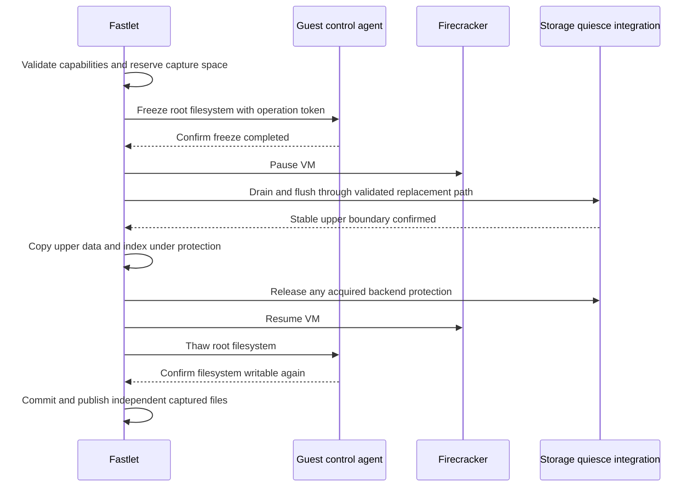
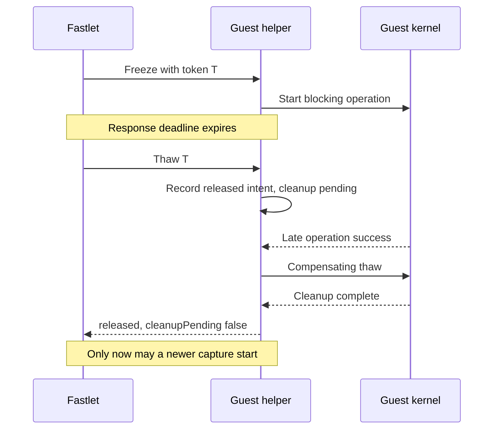
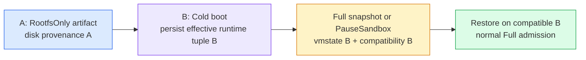

# FSEP-0001: Rootfs-Only Snapshots on the OverlayBD Path

## Problem and goals

Today every snapshot on the Firecracker runtime is a full snapshot: the produced OCI pair carries the guest memory (`memfile`) and device state (`vmstate.bin`) next to the committed writable layer (`internal/runtime/firecracker/oci_upper.go`, `cmd/fsb-vm/pack.go`). Full snapshots buy millisecond in-place resume, but they cost three things:

1. **Artifact weight.** The snapfiles layer always contains a memory-sized file. The OCI staging footprint formula is `3*(upper + memory) + 512MiB` (`snapshot_driver.go:403-420`), and the pause window contains a memory dump even with the spill-directory optimization (7.2s → 258ms at 512MiB, `docs/guides/sandbox-snapshots.md`).
2. **CPU portability.** Restore compatibility is pinned to the snapshot's CPU family/model/stepping, CPU template, and an exact Firecracker version (`internal/artifacts/manifest.go:522-558`, `docs/guides/snapshot-cpu-compatibility.md`). A full snapshot taken on one node generation cannot resume on another.
3. **Resume semantics that many use cases do not need.** Persisting a workspace between sessions, checkpointing build or scratch state, or producing a template that many sandboxes start from only need the disk. For those cases the memory image is pure overhead, and the restraints it imposes (CPU pinning, memory-sized uploads) are pure loss.

This proposal introduces **rootfs-only snapshots** on the OverlayBD (OCI) path: a snapshot that persists only the writable layer and whose consumers **boot** rather than restore-in-place. The design follows the model of E2B's filesystem-only snapshots: give up process continuity explicitly, gain a smaller, faster, CPU-portable artifact.

### Goals

- Add a `mode` option to live sandbox snapshots (`CreateSandboxSnapshot` / `SandboxSnapshot` CRD): `Full` (default, unchanged) or `RootfsOnly`, **OverlayBD path only** in this proposal.
- Produce a rootfs-only artifact as the existing OCI pair shape with a degenerate snapfiles layer, so resolution, digest addressing, immutable-tag publishing, and owner fencing are unchanged.
- Make restore **data-driven**: the artifact's manifest declares the mode; the runtime branches on it. `CreateSandboxRequest`, `PauseSandboxRequest`, `ResumeSandboxRequest`, and `RestoreSpec` do not change.
- Add the missing production cold-boot branch (today the driver is restore-only, `restore.go:3-12`) by reusing the template builder's boot recipe, including activation of the ADR-004 guest-kernel hook on nodes.
- Capture a guest-filesystem-consistent rootfs without generating a RAM dump. The primary path bypasses `PUT /snapshot/create`, retains VM Pause, and measures guest filesystem freeze time separately from vCPU pause time.

### Non-goals

- Application-transaction consistency, multi-volume atomic snapshots, live upper restacking, or eliminating VM Pause. Applications must flush their own user-space state when they require transaction-level guarantees.

- The S3/native artifact path. It can adopt the same mode later; this proposal rejects `RootfsOnly` there.
- `PauseSandbox` (checkpoint kind) with rootfs-only semantics. Changing what "Paused and resumed" means for a live sandbox is a separate decision; `SnapshotKindCheckpoint + RootfsOnly` is rejected by validation in this proposal.
- Diff or incremental memory snapshots (issue #56), same-node prewarming (#57), and manifest hashing overlap (#61).
- Per-instance entrypoint or env overrides at boot time. Cold boot makes this possible later; it is not specified here.

## Proposal and tradeoffs

### Artifact contract: a degenerate pair, self-describing

A rootfs-only snapshot keeps the exact shape of today's OCI checkpoint publish (`oci_checkpoint.go:100-158`, `pack.go:52-127`):

```
<id>_rootfs:     layers = [...inherited parent layers (remote refs), frozen upper committed as one new zfile]
<id>_snapfiles:  single ext4 layer containing manifest.json (+ optional vault/policy state files) — no vmstate.bin, no memfile
```

The rootfs manifest is unchanged in shape; this is the key observation that makes the proposal cheap: **the rootfs half of the pair already is the disk-only snapshot**. Only the snapfiles half degenerates from a memory-sized layer to a kilobyte-scale one. `manifest.json` stays exactly where it is today — a plain file on the snapfiles ext4 layer (`cmd/fsb-vm/build.go:719`) — so it remains the pair's resolution anchor and the first artifact mounted at create (`cmd/fsb-vm/create.go:186-196`, where the ordering exists precisely because manifest.json supplies the rootfs size; it now also carries `snapshotMode` and `kernel.cmdline`). The degenerate snapfiles disk is no longer sized from `memoryMiB`; it becomes a small fixed ext4 holding manifest.json plus optional state files. `resolvePair` digest addressing, `pushImmutableManifest` one-shot tags, `layoutIndex` two-image validation, and checkpoint owner annotations all continue to work unmodified.

The shared `VMManifest` (`internal/artifacts/manifest.go`) gains the following additive, optional fields:

- `platform.snapshotMode`: `"full"` (absent = full, for all existing manifests) or `"rootfsOnly"`.
- `kernel.cmdline`: the complete kernel boot arguments needed to cold-boot the disk (captured from the source template's build; see the restore section). `kernel.version` already exists and becomes the node-side kernel asset key.
- `guestControl`: the template capability declaration described below; capture requires a live compatible helper in addition to this metadata.

Why not a single image without the pair? Every consumer (`ocitemplate.ResolveFrom`, `resolvePair`, `ValidateDigestReference`, resume references recorded in `status.runtime.checkpoint` and `SandboxSnapshotStatus`) addresses the pair by the snapfiles manifest digest. Dropping the pair would churn the entire resolution contract for no functional gain. The degenerate snapfiles layer costs kilobytes.

Why data-driven restore instead of a request field? The artifact knows what it is; the requesters should not have to say so, and pause/resume flows that carry only `{ManifestRef, ArtifactDigest}` keep working without protocol changes. This also matches the "snapshot content vs restore policy are orthogonal" split: a future `resumeWithoutMemory` option would be a request-side choice over a full artifact, the mirror image of this proposal.

### RPC and contract changes

Four layers carry the mode, all aligned by `make generate`. Only the snapshot-creation side changes; the restore side reads the artifact.

**FastPath gRPC** (`api/proto/v2/fastpath.proto`):

```proto
enum SnapshotMode {
  SNAPSHOT_MODE_UNSPECIFIED = 0; // resolves to FULL for compatibility
  SNAPSHOT_MODE_FULL = 1;
  SNAPSHOT_MODE_ROOTFS_ONLY = 2;
}

message CreateSandboxSnapshotRequest {
  // ... existing fields 1-4 unchanged ...
  // mode selects what the snapshot persists. FULL (default) captures memory
  // and device state; ROOTFS_ONLY persists only the writable rootfs layer and
  // consumers boot from disk. ROOTFS_ONLY requires the OverlayBD artifact path.
  SnapshotMode mode = 5;
}

message SandboxSnapshotInfo {
  // ... existing fields 1-13 unchanged ...
  SnapshotMode mode = 14;
}
```

`CreateSandboxSnapshot` rejects `ROOTFS_ONLY` with `INVALID_ARGUMENT` before persisting the intent when the sandbox is not on the OCI path — the sandbox is not touched, matching the fail-fast style of the existing reentrancy checks (`fastpath/snapshot.go:117-131`). `SandboxSnapshotInfo.mode` reports the mode of an existing snapshot so clients can tell artifact classes apart.

**SandboxSnapshot CRD** (`api/v1alpha2/sandboxsnapshot_types.go`):

```go
// +kubebuilder:validation:Enum=Full;RootfsOnly
// +kubebuilder:default=Full
type SandboxSnapshotMode string

type SandboxSnapshotSpec struct {
    SandboxRef  SandboxRef          `json:"sandboxRef"`
    TemplateName string             `json:"templateName,omitempty"`
    // Mode selects what the snapshot persists. RootfsOnly requires the
    // OverlayBD artifact path and is rejected for checkpoint-style use.
    Mode SandboxSnapshotMode        `json:"mode,omitempty"`
}
```

The spec stays immutable by convention (one-shot intent). Normalize absent, UNSPECIFIED, and explicit Full before computing `SnapshotSpecHash`, preserving existing Full hashes. A replay that changes the effective mode is rejected as spec drift.

**Fastlet protocol** (`internal/protocol/fastlet/types.go`): `SnapshotSpec.Mode` (`full` default / `rootfsOnly`). `validateSnapshotRequest` (`internal/fastlet/sandbox/snapshot.go:176-193`) rejects `rootfsOnly` for non-OCI sandboxes and for `SnapshotKindCheckpoint`.

**Runtime contract** (`internal/runtime/contract/runtime.go`): `SnapshotInput.Mode` with the same two values. The contract requires confirmed guest filesystem freeze before VM Pause, an explicit storage barrier before upper capture, and bounded recovery of backend writes, VM execution, and guest filesystem writes on both success and failure paths. An unrecoverable source must be reported as unhealthy/lost, never as a successful snapshot with a healthy source.

SDKs regenerate stubs only; `pkg/sandboxclient` and the Python SDK add optional convenience later. `fastctl` is unchanged.

### Snapshot production: filesystem-consistent capture without a memory dump

The primary implementation bypasses `PUT /snapshot/create`; it does not write temporary vmstate or memory files. Guest filesystem freeze, VM Pause, and upper capture are separate operations: freeze synchronizes the guest filesystem and prevents new filesystem modifications; Pause stops vCPUs; the storage barrier makes the upper data/index pair stable for capture. None is a synonym for another.

**Existing Full capture baseline.** `snapshot_driver.go` currently runs Pause → snapshot/create → `captureOCIUpper` → Resume. The upper helper explicitly requires completed drive drain/flush and paused vCPUs; it does not acquire a separate OverlayBD barrier lock. Here, “barrier” means the proven stable capture boundary, not a requirement to introduce a new service or Acquire/Release API. Bypassing snapshot/create must replace its relevant device preparation and completion guarantees. An independent backend exclusion mechanism is needed only if the actual storage behavior requires it.

Guest freeze adds the filesystem consistency required when RAM is discarded. Full retains Guest-memory state; rootfs-only needs a filesystem state that can boot independently. This is separate from draining host-side I/O. Existing Full sequencing is the reuse baseline, not proof that every asynchronous write or error case is covered.

**Consistency scope.** v1 captures the supported guest root filesystem on the OCI root drive. A successful freeze must complete filesystem transactions and synchronize filesystem data and metadata through the supported block stack. This does not flush application user-space buffers, commit application transactions, include tmpfs or external volumes, or promise multi-volume atomicity. Bypass writers to the raw root device must be excluded by the supported guest contract. Unsupported guests or storage configurations are rejected, not downgraded to sync-only or crash-consistent capture.



1. **Preflight.** Verify guest freeze/thaw support, a tested storage-quiesce capability, boot metadata, ownership/generation, and reserved space before freezing. Existing templates without the required guest protocol or boot recipe are rejected until rebuilt or explicitly migrated. Rootfs-only is not silently converted to Full.
2. **Guest freeze.** An authenticated, privileged guest control channel performs the filesystem freeze operation, such as `FIFREEZE` on the ext4 root mount, while vCPUs are still running. Plain `sync` is insufficient: writes can occur between sync completion and Pause. Freeze/thaw must be serialized, idempotent for an operation token, and usable without writing to the frozen filesystem. The agent must enforce a bounded freeze lease/watchdog and report whether protection expired. A lost acknowledgement is an ambiguous freeze, not proof that no freeze occurred.
3. **Pause.** Pause vCPUs only after freeze confirmation. Prevent overlapping lifecycle/capture operations. If the freeze lease expires before Pause, abort capture. Lease expiry while paused must also invalidate capture unless the protected interval is conclusively established; recovery resumes the VM before requesting guest thaw.
4. **Backend barrier, drain, and flush.** Establish an explicit boundary that allows earlier writes to complete while preventing later mutations from racing capture. Account for Firecracker file-engine work, kernel block-device writeback, ublk requests, and OverlayBD data/index state. Verify the virtio cache/flush configuration and propagate failures across the supported stack. A barrier that blocks the writes needed to drain can deadlock. Empty ublkd queues or unchanged upper file sizes/timestamps are not a completion proof.
5. **Cut.** With the boundary held, reuse the copying machinery in `captureOCIUpper`: reflink, sparse extent copy, or sparse scan, producing independent `rootfs.upper.data/index` and `rootfs-upper.json`. The helper's existing snapshot-create precondition must be satisfied by the validated replacement path; the copy implementation remains reusable. Two reflinks are not a multi-file transaction: protection remains held until both files and their capture metadata are complete. v1 does not seal or restack the live upper. A partial capture is never published.
6. **Recover the source.** Release any explicitly acquired backend protection, Resume vCPUs, and confirm guest thaw, in that order. Only then hand independent capture files to asynchronous commit, pack, squash, and push. Upload failure must not refreeze the source.

**Implementation gate.** The current FSB clients do not expose a standalone VMM disk-drain or ublkd quiesce API. The above is a required protocol, not a claim that these calls already exist. Do not rely on RAM-dump duration to allow incidental backend work to finish. Before enabling RootfsOnly, the implementation must specify and test the concrete guest channel and backend operations, including the proof that no delayed VMM write can arrive after the acknowledged boundary. In particular, guest freeze completion must be validated against actual cache/flush semantics; backend idle polling is not a substitute. If the deployed stack cannot provide this boundary without a VMM change, keep the mode disabled and revisit the alternative below instead of weakening consistency.

**Failure recovery.** Persist capture phase, source generation, operation token, and cleanup obligations before issuing freeze/Pause/barrier actions. Cleanup runs on success, errors, timeouts, and cancellation, with its own bounded context rather than an already-cancelled request context. Fastlet restart reconciles unfinished operations. Resolve ambiguous Pause outcomes under the lifecycle fence; resolve freeze/barrier outcomes using the terminal-token and late-completion rules below, not status polling or idempotency alone; release backend protection before Resume and thaw only after the guest can execute. A timed-out request does not cancel an in-flight VMM or storage operation. Discard an ambiguous capture and establish completion or failure before ordering Resume, thaw, or a successor operation. If completion cannot be established within the recovery budget, quarantine the source for reconciliation. A watchdog alone cannot thaw a paused VM. If Resume or thaw cannot be confirmed, mark the source unhealthy/lost and fail the operation; VMM death cannot be repaired by Resume. Do not report success merely because captured files exist.

**Resources and packaging.** Reserve space for the upper copy, pack/squash intermediates, and metadata with concurrent admission accounting; rootfs-only has no RAM-sized spill or staging allocation. Derive the reservation from actual copy/packing behavior rather than assuming a fixed `2*upper` formula. Full snapshots retain their existing spill behavior. `fsb-vm pack --rootfs-only` stops requiring vmstate/memory files and writes metadata-only snapfiles; lower inheritance, zfile commit, and pair publishing are reused.

**Latency.** Removing the RAM dump eliminates that component of capture cost, not all pauses. Report guest freeze-to-thaw time, vCPU Pause-to-Resume time, upper-copy time, and publish time separately. Sparse-copy fallback can dominate the protected interval. The historical 512MiB spill measurement is a comparison baseline, not a guarantee for this new protocol.

### Deployment-derived qualification (Issue #184)

The default OverlayBD deployment uses the source instance's persisted managed Firecracker selection. Versioned delivery verifies the executable pair; capture compares the running VMM with that selected binary, rather than a separate global checksum manifest. Only Firecracker 1.17.0 is accepted for capture, including custom binaries; an explicit digest cannot bypass this lifecycle gate. Older templates keep their selected version and Full restore rules. This does not enable cross-version restoration or rewrite manifests.

The kernel expectation comes from the source manifest's boot provenance. Resolve the OCI `current` link once per qualification so its checksum entries and `REVISION` belong to one release, and require `REVISION` to match the checksum-manifest digest. The node daemon always attempts to publish its observed process digest bound to the socket and boot ID. Fastlet compares that observation with the release bundle expectation. Attestation failure revokes the record and disables RootfsOnly without stopping healthy Full storage operation.

`FAST_SANDBOX_ROOTFS_QUALIFICATION` is an optional partial override; explicit malformed values or `exclusiveExt4: false` reject capture. The standard managed VMM directory and state root imply the platform's exclusive-ext4 deployment contract; custom topologies must declare it explicitly, and custom VMMs require an explicit digest. Filesystem detection alone cannot establish absence of raw block, swap or host bypass writers. FSB components are upgraded together; no mixed-FSB-release compatibility is promised. Release validation still qualifies the shipped kernel/storage/VMM combination.

### Guest control: ownership, delivery, and capability gate

**Proposed v1 decision, pending maintainer acceptance.** FSB owns a dedicated `fsb-guest-control` helper and host client, separate from execd and the user-facing data plane. Use a private virtio-vsock control channel for the minimal protocol below, keeping privileged filesystem control independent of user networking, execd availability, and its release cycle. The cost is a new helper and device/template integration. This is new implementation work, not an existing FSB capability. Mandatory guest-filesystem consistency adds helper, device, and template dependencies beyond simply removing a memory dump; accepting this draft explicitly accepts that scope. No OpenSandbox API or execd change is required for freeze/thaw.

| Owner / component | Required delivery |
|---|---|
| FSB Guest helper | Privileged root-filesystem freeze/thaw, capability/status reporting, serialized operation state, lease watchdog, and late-completion cleanup |
| FSB template builder | Package a versioned helper into the guest image, start it from guest-init before user workloads, configure vsock in template VM creation, and record the capability only after an end-to-end probe |
| FSB Firecracker runtime | Configure the vsock device and private host socket for cold boot and compatible full-template restore, implement the client, bind requests to the current VM incarnation, and reconcile interrupted capture |
| FSB Fastlet | Persist capture intent and cleanup obligations, fence ownership changes, enforce deadlines, and reject unsupported source templates before side effects |
| FSB storage integration | Deliver and validate the replacement drain/completion/flush path and stable capture boundary; introduce backend exclusion only if required by the deployed stack |

The host socket is per VM, accessible only to the runtime service and trusted host administrators, and is never routed through the sandbox proxy. The helper accepts control requests only from the host vsock peer; host socket permissions and peer validation form the channel authentication boundary, while operation IDs provide fencing, not authentication. Do not bake reusable bearer credentials into templates. Runtime setup must test the deployed Firecracker vsock transport and kernel support, including full-template restore and reconnect after Pause. A privileged malicious guest can defeat its own filesystem consistency; this contract assumes the managed helper and excludes raw-device bypass writers.

The helper opens the root mount before freezing. Its control loop, state, watchdog, and logging must run without writable-rootfs dependencies: keep runtime state in memory or `/run` tmpfs and avoid shell/execd subprocesses or blocking disk logging during freeze. Run the potentially blocking freeze ioctl separately from the responsive control loop. A helper crash or lost state is an ambiguous protection state, not permission to start a fresh operation.

The additive manifest declaration is `guestControl: { protocol: "fsb-freeze-v1", transport: "vsock", port: <reserved-port>, helperVersion: <version> }`. The implementation reserves one port consistently across builder and runtime. The builder must validate the helper, guest-kernel vsock support, device configuration, and freeze/thaw behavior before emitting the declaration. Fastlet requires both this declaration and a live handshake reporting compatible protocol, current agent epoch, and the expected root mount. Missing declaration, unsupported version, failed probe, or incompatible restored-device configuration rejects RootfsOnly before freeze. Old templates remain usable for Full but must be rebuilt to gain this capability; adding metadata alone is not a migration. Rootfs-only descendants retain the helper and declaration, which are revalidated before a subsequent capture.

**Builder injection is unconditional on the OverlayBD build path, with no opt-out.** An earlier implementation gated the helper injection and the build-time freeze/thaw probe behind an `FSB_GUEST_CONTROL_ENABLED` environment variable read only by the builder binary. That switch had no deployment surface: the build Pod's environment is a platform-owned, closed list and no chart value, controller flag, or sample set the variable, so no deployment could ever enable it and every built template lacked the declaration. The gate is removed instead of propagated. OverlayBD builds always inject the statically linked helper, start it from guest-init, and run the probe; an incompatible helper or guest vsock stack fails the build instead of shipping a template that silently cannot capture, and the probe, not operator configuration, is the validation gate. The capability is inert unless a capture uses the control channel, so the helper and vsock device cost nothing at runtime for Full snapshots and Pause/Resume. Native (object-store) templates do not carry the helper because rootfs-only capture is OverlayBD-only. Existing templates are unchanged; rebuilding remains the documented migration path, and capture-time revalidation (declaration plus live freeze/thaw handshake) keeps a broken helper from passing a qualified runtime.

### Operation protocol: cancellation fences late completion

Every request carries the VM incarnation, capture generation, unique operation ID, and expected agent epoch. Generations are monotonic within an incarnation and fenced by the current Fastlet owner. Freeze requests include a bounded lease duration, started when the service first accepts the token; retries never extend that lease. Fastlet separately tracks its own host deadline. Replays must match the original parameters. The guest helper implements the following semantics. These rules also apply to any asynchronous backend acquisition introduced by the bypass implementation. They do not require creating a separate backend barrier service.

| Operation | Required response / semantics |
|---|---|
| `Capabilities` | Protocol, agent epoch, supported root mount, lease limits; verifies the live endpoint rather than only template metadata |
| `Freeze` | Register `pending` before invoking the side effect; report `held` only after successful completion and a recheck that the token is neither terminal nor expired |
| `Status` | Return `pending`, `held`, `released`, or `expired`, plus `cleanupPending`, failure reason, and agent epoch; `unknown` is explicitly ambiguous, never equivalent to released |
| `Thaw` | Also cancels an in-flight or not-yet-seen freeze for that token. Record irreversible `released` intent before cleanup. Replays are idempotent; successful completion requires `cleanupPending=false` |
| Lease expiry | Record irreversible `expired` intent, invalidate capture, and perform the same cleanup as release. Expiry never permits reacquisition with the same token |

A token in `released` or `expired` can never transition back to `pending` or `held`. A thaw received before a freeze creates a tombstone, so a delayed freeze cannot take effect. A blocking kernel call that already started may still succeed after cancellation: its completion handler must check terminal intent, immediately perform compensating thaw, and never acknowledge `held`. Terminal intent is not proof of completed cleanup; keep `cleanupPending=true` until all in-flight work and compensation have finished. If this cannot be confirmed within the recovery budget, fail capture and quarantine the source rather than claiming it is writable.



Keep the source-wide lifecycle fence until the old operation and its compensation complete. Otherwise a late thaw for token T could unfreeze a newer token even though token T was correctly canceled: Linux filesystem thaw does not understand FSB operation IDs. Retain terminal records or a generation high-water mark for the VM incarnation; never garbage-collect them in a way that admits stale requests. A helper restart changes its epoch and invalidates old requests and captures. Reconcile any possibly held protection and old workers before admitting a new operation; if that cannot be established, quarantine the source. A full-template restore starts a new VM incarnation and must perform this handshake before advertising capture support.

Fastlet persists the terminal decision before sending cleanup, preventing a restarted coordinator from replaying freeze after cancellation. After confirmed source recovery, it may publish only a capture whose entire cut completed under valid protection; any ambiguous or expired protection during the cut invalidates the artifact. Guest watchdog time cannot bound host wall-clock time while vCPUs are paused: the host independently enforces the capture/recovery deadline and resolves outstanding VMM work, releases any acquired backend protection, performs Resume, then guest cleanup. Neither watchdog nor cancellation is a guarantee that a stuck kernel call can be interrupted.

### Replacement drain/flush path: implementation obligations

Fastlet's Firecracker runtime adapter coordinates the capture; the runtime/storage integration owns the replacement completion boundary and its acknowledgement. The concrete API mapping and Linux/KVM/ublk PoC remain prerequisites for enabling the mode. The primary design still bypasses snapshot/create and produces neither RAM nor temporary vmstate. Selecting a custom snapshot API would be a separate design decision.

**What a bypass implementation must actually supply.** The current FSB client has no standalone VMM disk-drain API. Calling host `sync`, fsyncing upper files, or polling ublkd cannot observe all VMM-owned in-flight work. A dedicated VMM quiesce operation could reuse existing internals rather than reimplementing them, but it would still require a reviewed API and VMM release. The minimum obligations are:

| Layer / responsibility | Required implementation or proof |
|---|---|
| VMM execution boundary | Require paused vCPUs, serialize with the VMM event loop and lifecycle changes, and prevent new device submissions from invalidating the acknowledged cut |
| File-engine drain | For async I/O, wait for submitted operations (`submit_and_wait_all` in the inspected source); cover the deployed sync engine as well. Do not equate file-engine drain with consuming every pending guest virtqueue descriptor |
| Completion processing | Preserve async completion handling, request status/used-ring updates and required notifications so the source can Resume correctly; no completion may still mutate the captured backend afterward |
| Flush and errors | Flush the backing block FD through the supported host/ublk/OverlayBD path; verify how upper data/index become stable and how submission, completion, and flush errors reach the caller |
| Rootfs-only consistency | Keep Guest freeze before Pause; VMM drain does not flush Guest dirty pages or application buffers. Define the supported cache/flush configuration and exclude raw-device bypass writers |
| Capture lifetime | Copy both upper files under the proven stable interval. Add a backend exclusion mechanism only if backend behavior actually requires one; if added, define acquisition, release, and late-operation fencing |
| Recovery and validation | Resolve lost replies and outstanding work before Resume, thaw or a successor operation; stress delayed writes and source recovery. No idle polling or arbitrary sleep substitutes for completion |

A bypass path does not need to serialize CPU/device state or RAM merely to export the rootfs, but it must retain whatever device bookkeeping is required for safe continuation and subsequent Full snapshots. This is why it is more than reproducing a `drain(); flush()` pair outside the VMM.

**Device-lifecycle caveat: plain Resume is not necessarily snapshot-independent.** An ARM64 nested-KVM experiment with upstream Firecracker v1.16.1 (revision `2038188f145fb81b8d098147a10e9d9f392fd22f`) reproduced a vsock failure after plain Pause → Resume, even without Guest freeze: vCPUs and a Guest heartbeat continued, but a new host-to-Guest connection timed out. On the same VM, Pause → Full snapshot/create → Resume restored connectivity; another plain Pause → Resume broke it again. In that revision, [`Vsock::kick`](https://github.com/firecracker-microvm/firecracker/blob/2038188f145fb81b8d098147a10e9d9f392fd22f/src/vmm/src/devices/virtio/vsock/device.rs#L405), called during Resume, sets `pending_event_ack`, while [`prepare_save`](https://github.com/firecracker-microvm/firecracker/blob/2038188f145fb81b8d098147a10e9d9f392fd22f/src/vmm/src/devices/virtio/vsock/device.rs#L450) supplies the transport-reset event. Bypassing snapshot creation can therefore leave RX gated on an acknowledgement for an event that was never supplied. This is evidence for the tested version and environment, not a claim about all Firecracker releases or architectures.

The bypass implementation must audit device preparation and continuation together, distinguish ordinary Resume from snapshot restore, and preserve reset/acknowledgement behavior required by real restore. Do not remove that behavior indiscriminately or silently invoke Full snapshot creation as a workaround. Qualify the deployed VMM using repeated plain Pause/Resume cycles, new Guest-control connections, freeze/thaw recovery, and subsequent Full snapshot/restore. A successful Resume API reply alone does not establish Guest-control recovery. If the control channel cannot recover, do not publish the capture or admit another operation; resolve or quarantine the source under the recovery policy. Until the deployed version passes these checks, vsock-based thaw is an implementation blocker alongside the replacement I/O boundary.

**Validation boundary.** The replacement path requires Linux/KVM/ublk experiments on the deployed stack: buffered guest writes, delayed I/O, errors, and writes between data/index copies must not yield a successful inconsistent artifact. Full's current sequencing is the reuse baseline, not a substitute for these tests. A coherent cut and power-loss durability are distinct claims. Pause remains required in v1; no-Pause capture and live restacking are separate designs.

**Error propagation.** The inspected upstream Firecracker block-device wrapper logs drain/flush failures instead of returning them from `prepare_save`; the inspected E2B branch uses `expect` and can terminate the VMM. Neither policy should be inherited without review. The replacement path must surface submission, completion, and flush failures to the capture caller, avoid publication, and preserve source recovery when safe. A source that cannot safely recover must be reported unhealthy/lost.

### Alternative for discussion: E2B-style optional memory output

E2B's public runtime calls `snapshot/create` without `mem_file_path` even for filesystem-only capture. Its public `firecracker-v1.14-direct-mem` branch makes that field optional: `save_state` and vmstate output still run, preserving device preparation/drain/flush, while RAM output is skipped. Filesystem-only also skips the runtime's separate memory export. Guest freeze and VM Pause remain distinct steps.

| Choice | Benefit | Cost |
|---|---|---|
| Primary: bypass snapshot/create | No vmstate or RAM output; avoid requiring a VMM fork if the storage protocol can be proven | Must implement and validate the cross-layer barrier described above |
| Alternative: optional memory output in a custom VMM | Reuse VMM device preparation and completion handling without RAM dump | Maintain a VMM patch/release; still write vmstate; validate guest freeze and OverlayBD capture separately |

This alternative is not an automatic fallback. Adopting it requires a reviewed update to implementation and acceptance criteria, particularly temporary vmstate output. The inspected public E2B branch also hard-crashes on block drain/flush failure rather than merely logging the error; FSB must explicitly choose its failure policy instead of copying that behavior. E2B uses its own NBD/COW storage path, so its storage-cut implementation is not an OverlayBD API. The current public runtime build script points to another repository that was not publicly readable during this review; the references below establish the public branch mechanism, not the contents of every current release binary.

### Restore: booting a new sandbox from a rootfs-only artifact

`EnsureSandbox`'s OCI branch learns one branch point. `readPreparedOCIMetadata` (`oci.go:218-262`) reads the manifest from the (tiny, shared-cached) degenerate snapfiles mount; when `platform.snapshotMode == "rootfsOnly"` the driver takes the new **boot path** instead of `LoadSnapshot`:

1. `fsb-vm create --prepare-only` keeps the attachment order but gains mode-aware validation: resolve the pair, attach the rootfs device (all layers as lowers, lazy range-read from the registry, fresh blank hybrid upper), acquire the ublk lease. The acquire order is untouched — the degenerate snapfiles still attaches and mounts **first**, because manifest.json on it supplies the rootfs virtual size and now the mode and boot cmdline; degenerate snapfiles ride the existing shared-snapfiles cache, whose key dedupes by layers and credential scope as today, so many sandboxes from the same artifact share one KB-scale mount. Chain snapshots also keep working unchanged: `captureOCIUpper` reads the source manifest from the current sandbox's snapfiles mount, degenerate or not.
2. `prepareOCIInstance` skips the vmstate/memfile bind mounts and instead bind-mounts the **guest kernel** into the jail root.
3. The driver issues the boot sequence, reusing the builder's proven recipe (`cmd/sandboxtemplate-builder/snapshot_stage.go:335-393` and `cmd/fsb-vm/build_firecracker.go:135-216` are the references; the runtime `Client` already exposes the calls):
   - `PUT /machine-config` from `manifest.machine` (`smt=false`; CPU template chosen by host vendor as at build time — **not** required to match the source snapshot's template).
   - `PUT /balloon` (free-page-reporting) and `PUT /entropy` (virtio-rng; together with `random.trust_cpu=on` this is required or execd's RNG blocks forever at session-id generation).
   - `PUT /boot-source` with the node kernel asset and `manifest.kernel.cmdline`. The cmdline is captured at template build and carries the baked network (`ip=172.30.0.3::172.30.0.1:...::eth0:off`), `init=<guest-init path>`, `root=/dev/vda rw`, and console arguments — identical strings to `snapshot_stage.go:124-126`.
   - `PUT /drives/rootfs` with the relative `rootfs.dev` path (the existing drive-naming contract).
   - `PUT /network-interfaces/eth0` with the slot tap and the manifest's baked guest MAC.
   - Configure the private vsock device and host socket declared by `guestControl`; the runtime client and template builder gain this new wiring.
   - `InstanceStart`.
4. Admission deltas versus restore: `requireStaticGuestNetwork` stays (the boot cmdline needs the baked network); `checkRestoreCompatibility` is **exempted** — CPU family/model/stepping, CPU template, and exact-Firecracker-version matching are vmstate constraints and do not apply to a boot. Apply this separation in the CLI `validateManifest`, shared `VMManifest.Validate`, and driver, not only `checkRestoreCompatibility`: the CLI validates before returning from `--prepare-only`. Keep architecture, schema, machine, kernel/boot and device checks. Source CPU identity is provenance, not cold-boot admission; application ISA and guest-kernel compatibility still constrain portability.

**Guest kernel assets (activating the ADR-004 hook).** `resolveKernel` (`create.go:353-367`) already defines `<kernel-dir>/vmlinux-<manifest.kernel.version>` but only as an existence check on the standalone path. This proposal activates it: the runtime-agent installs kernel bundles next to the OCI tool bundle using the same immutable release-dir channel (`/opt/fast-sandbox/oci/releases/<digest>` style); `hostready.CheckOCI` verifies `vmlinux-<version>` presence and exports a node label; `fsb-vm create` records the resolved `kernel_path` in `state.json` (also under `--prepare-only`, where the check currently returns early); the driver reads it for the boot-source call. Nodes without the required kernel fail before VM boot; any metadata attachment already acquired must be cleaned up. Snapshot creation needs the boot recipe and guest/storage capture capabilities, but not a host-local boot kernel. Kernel verification today is filename-convention only; recording the kernel blob digest in the manifest for verification at boot is a hardening follow-up listed under open questions.

**How the sandbox becomes usable: guest-init, execd, entrypoint.** Reuse the builder's bootstrap contract, with the new FSB control helper started before user workloads:

- `guest-init` (the injected PID 1, `convert.go:338-415`) is already on the disk. On every boot it mounts `/proc`, `/sys`, `/dev` behind `mountpoint` guards, mounts **fresh tmpfs on `/run` and `/tmp`** (masking stale runtime state), brings up loopback, sources `/etc/sandbox-init.env`, and runs the readiness loop. It was audited for repeat runs during template builds; repeated cold boots exercise the same code path.
- **execd registration requires no guest-side work.** execd never registers anywhere today: routing is host-side discovery — the slot netns DNATs `slotIP:44772` to the guest's baked IP, fastlet-proxy publishes the route from placement, and `X-Fast-Sandbox-Route-Credential` is an Ed25519 token issued and verified entirely host-side (`internal/dataplane/`). After a cold boot the only thing that must happen is execd listening on 44772 again: guest-init launches `/opt/opensandbox/bootstrap.sh`, which starts execd; fastlet's existing `InitializeInstance` HTTP/TCP probe (`infra_lifecycle.go:218-267`) re-probes until it answers and turns the sandbox `DataPlaneReady`. The egress MITM CA was installed into the guest trust store at the original snapshot boot and lives on the disk, so cold-booted sandboxes inherit it exactly like restored ones ("restored sandboxes trust the CA from first boot").
- **The user entrypoint re-executes on every boot.** `/etc/sandbox-init.env` carries `ENTRYPOINT`; guest-init passes it as `BOOTSTRAP_CMD` to `bootstrap.sh` (or `setsid sh -c` directly). This is a semantic change worth stating loudly: a full restore never re-runs the entrypoint (the process is in the memory image), a rootfs-only boot always does. User processes running at snapshot time are not resurrected; anything that must survive must live on disk, and anything that must run must be restartable (or re-run via ENTRYPOINT).

**Readiness signaling.** Production does not depend on the serial console. The VM is `RuntimeReady` when Firecracker reports Running; guest-level readiness is the existing re-probe: the readiness contract inside the guest (ReadinessSpec probe → execd ping → warmup+healthcheck, in that priority) gates `SANDBOX_READY`, and host-side the fastlet infra probe supplies the externally visible signal. The boot timeout budget uses the builder's calibration (boot-to-ready measured 2.1s on the reference builder for an execd-ping template; budget `warmupSeconds + 60s`, floor 300s, `snapshot_stage.go:596-602`). Serial console capture stays available for diagnostics, as in the builder.

`fast-sandbox.json` (VM discovery metadata) is boot-mode agnostic and continues to be written best-effort.

### Compatibility of Full checkpoints after cold boot

Disk lineage and live-instance restore requirements have different owners. After a RootfsOnly artifact from environment A cold-boots in environment B, any new Full snapshot or checkpoint must describe the VM actually running in B. `assembleSnapshotManifest` currently inherits the source manifest's `compatibility` block; retaining that behavior would label B's vmstate with A's CPU template/identity and Firecracker version, potentially rejecting restore even on B.

| Metadata | Source for a cold-booted descendant's Full snapshot |
|---|---|
| Disk lineage / source artifact | Preserve the source artifact provenance from A |
| `compatibility.cpuArch`, CPU vendor/family/model/stepping and CPU model name | Record the actual execution host for this VM incarnation on B |
| `compatibility.cpuTemplate` | Record the effective template applied to this VM, not the source disk's template or a newly recomputed default |
| `compatibility.firecrackerVersion` | Record the resolved version of the binary actually launched for this VM, not the binary currently installed when capture runs |
| Other compatibility provenance, including host kernel | Populate from the same instance startup record under the existing compatibility schema |

The runtime must durably record the effective compatibility tuple, bound to the VM incarnation, as part of successful startup before admitting snapshot/checkpoint operations. Fastlet restart must recover that record. A later node-tool upgrade must not rewrite the identity of an already-running VMM. On a subsequent Full restore, retain the effective restored CPU configuration and record the actual admitted execution environment for the new incarnation; do not substitute cold-boot defaults.

When producing a Full artifact, `assembleSnapshotManifest` must replace inherited compatibility with this instance record and explicitly set the effective snapshot mode to Full, rather than carrying forward `rootfsOnly`. Apply this to both explicit Full snapshots and Full checkpoints created by `PauseSandbox`; the latter's public semantics remain unchanged. Missing or mismatched runtime metadata on a cold-booted descendant must fail capture before publication, not fall back to A's provenance. Existing legacy Full instances retain their current compatibility policy; the new record is mandatory for RootfsOnly cold-booted descendants and their subsequent lifecycle. This proposal does not relax Full restore admission.



### Runtime guarantees and constraints

| Aspect | Full snapshot (today) | Rootfs-only snapshot |
|---|---|---|
| Writable layer (disk) | Preserved | Preserved |
| Guest RAM | Preserved | Discarded |
| Processes at snapshot time | Restored in place | Not restored in the new instance; source resumes after capture |
| execd | Resumes with memory | Restarted by guest-init, re-probed by fastlet |
| User entrypoint | Never re-runs | Re-runs on every boot |
| `/run`, `/tmp` | Carried in memory image | Fresh tmpfs per boot (stale state masked) |
| Route/credentials | Host-side, unchanged | Host-side, unchanged |
| Resume latency | Milliseconds (restore) | Seconds (boot + readiness re-probe) |
| CPU compatibility | FMS + CPU template + exact Firecracker version | Architecture and cold-boot contract; application ISA must be supported |
| Artifacts | Pair + memory-sized snapfiles | Pair + kilobyte snapfiles |
| First-request latency | Guest network stack warm | ARP/neighbor caches cold; first request slower (observed pattern: sub-second settle) |

Explicit constraints:

- **OverlayBD path only.** `RootfsOnly` with the S3/native artifact format is rejected by validation on every layer.
- **Template kind only.** `SnapshotKindCheckpoint + RootfsOnly` is rejected; `PauseSandbox` is untouched and keeps producing full checkpoints.
- **Kernel-present nodes.** Booting a rootfs-only artifact requires the node kernel asset matching `manifest.kernel.version`; admission fails fast when the hostready label is absent.
- **Guest contract.** The injected guest-init is idempotent (verified by code audit: mount guards, tmpfs masking, stateless readiness loops). `bootstrap.sh` ships in the execd image outside this repository; its re-run behavior — notably the MITM CA trust-store installation — is an upstream contract item this proposal adds to the execd image's verification checklist. Application-level restart idempotency (locks, one-time migrations) is the user's responsibility and is documented as such.
- **Layer chain growth.** Each rootfs-only snapshot commits one new zfile layer over the inherited lowers; the 24-layer/16-layer squash with the never-merged `BaseLayers` boundary (`pack.go:228-257`) applies unchanged. Cheaper snapshots invite more frequent checkpointing, which accelerates chain growth and squash-driven blob pulls (`ensureLocalBlob`); per-mode squash thresholds are an open question below.
- **One-directional artifact class.** A rootfs-only pair cannot later be "upgraded" to a full pair: the memory of that moment is gone. Semantically this is the same as any missed snapshot; stating it prevents surprises.

### Tradeoffs, risks, and open questions

The main tradeoff is resume latency and process continuity in exchange for artifact weight, export speed, and CPU portability — accepted because the targeted use cases (workspace persistence, build-state checkpoints, template seeding) do not need running processes back. The main risks:

1. **Cold boot is a new production path.** The driver has never booted a VM outside the builder. Mitigation: the recipe is copied from the builder's proven sequence, and the boot branch is inert until a rootfs-only artifact exists.
2. **Filesystem and backend quiescence.** v1 requires confirmed guest freeze and a proven cross-layer barrier without snapshot-create. This is an enablement prerequisite, including bounded failure recovery, not a deferred correctness optimization.
3. **bootstrap.sh re-run semantics** is owned outside this repository; treated as a contract item with an E2E guard (repeated boots from the same artifact).

Open questions for review: per-mode squash thresholds; recording the kernel blob digest in the manifest and verifying at boot; whether `templateName`-addressed creation should require the label-based scheduling hint or rely on fastlet-side failure; the pause-kind (checkpoint) rootfs-only variant and the S3-path variant as separate follow-up proposals.

## Compatibility

- **Defaults preserve behavior.** `mode` absent or `UNSPECIFIED` means `Full` on every layer; all existing snapshots, manifests, and flows are byte-compatible. `platform.snapshotMode` absent means `full`, so every existing `VMManifest` decodes as before.
- **Existing resources.** Existing full-snapshot artifacts are unaffected and remain resumable by old and new drivers. New rootfs-only artifacts are only bootable by drivers that implement this proposal; an older driver fails closed with an explicit restore validation error (the degenerate snapfiles layer has no `vmstate.bin`/`memfile`), never a silent full-restore attempt.
- **Version skew.** Old fastlets may ignore unknown JSON fields and silently execute Full. The controlplane must require an explicit rootfs-only capability before dispatch; the fastlet must verify local guest/storage prerequisites and validate the effective mode. Check the produced artifact mode before reporting success. Old controlplanes omit mode and continue using Full. Test real old binaries, not only rejecting stubs.
- **Guest/template compatibility.** The new private helper protocol and vsock device require builder/runtime/kernel support plus a validated template declaration and live handshake. Old templates are rejected for RootfsOnly capture, not silently upgraded; their Full behavior remains unchanged. Full templates containing the new vsock device must pass restore/reconnect coverage before being advertised as capable.
- **Public interfaces.** Additive only: proto enum plus one optional field on two messages; one optional CRD field with a default; internal protocol and runtime-contract structs gain one field. SDKs regenerate stubs (`make generate`); no SDK or CLI breaking change. `PauseSandbox`/`ResumeSandbox`/`CreateSandbox` requests are deliberately untouched (data-driven restore).
- **CRD validation.** `SandboxSnapshotSpec.Mode` uses an enum with `Full` default; immutability follows the existing one-shot spec convention rather than new CEL rules.

## Test plan

Unit (run anywhere, `make test SCOPE=unit`):

- Mode plumbing through all four contract layers, including `SnapshotSpecHash` covering the new field (request_id replay with a changed mode must be rejected).
- Validation matrix: `rootfsOnly` accepted for OCI template-kind; rejected for the S3 path, for `SnapshotKindCheckpoint`, unsupported guest/storage capabilities, and by the dispatch gate for a real old fastlet.
- `validatePackBundle` rootfs-only branch (no vmstate/memfile requirement); `assembleSnapshotManifest` writes `snapshotMode` and `kernel.cmdline`; `dumpFootprintBytes` OCI branch without the memory term.
- Guest protocol state machines: thaw before freeze, duplicate messages, conflicting replay parameters, cancellation during blocking acquisition, expiry, lost acknowledgements, epoch changes, and stale generations. A terminal token never becomes held; no successor is admitted while compensation is pending.
- Full manifest assembly for cold-booted descendants: replace A compatibility with the persisted effective B tuple, set Full mode, preserve disk lineage, reject missing/incarnation-mismatched records, and ignore later changes to the node-installed VMM binary. Verify both template-kind snapshots and checkpoint-kind artifacts.
- Admission branch: `readPreparedOCIMetadata` dispatches on `platform.snapshotMode`; compatibility exemption applies only to `rootfsOnly`.

E2E and integration (Linux, root, KVM, ublkd, XFS StateRoot; skipped platforms reported):

- **Lifecycle:** create a sandbox from an OCI template → write a file and start a background process → `CreateSandboxSnapshot(mode=ROOTFS_ONLY)` → source resumes and its rootfs is writable again (measure freeze-to-thaw and ping gap) → create a new sandbox from the snapshot → the file is readable, the old process is gone, execd answers `/ping`, entrypoint re-ran (boot-marker file with a boot count), sandbox reaches `DataPlaneReady` via the re-probe path.
- **Repeat boots:** boot the same rootfs-only artifact twice (chain: snapshot the booted sandbox again) — guest-init and bootstrap re-runs stay healthy; layer chain stays ≤ 24 with squash firing and `BaseLayers` preserved (`oci_chain_e2e_test.go` pattern extended).
- **Consistency:** exercise buffered writes, fsync and rename under load; verify freeze blocks later filesystem mutations, captured file contents and checksums match the protected boundary, and the assembled image passes filesystem checks. Inject delayed VMM/ublk writes and a write between data/index copies to validate the stable capture interval without relying on RAM-dump latency. Inject flush errors; none may produce a successful snapshot. Application transaction consistency is not inferred from e2fsck.
- **Capture regression:** verify rootfs-only followed by Full on the same source, error propagation from the replacement I/O path, and rejection of unsupported runtime capabilities before freeze. Preserve existing Full requests and their memory output.
- **Cold-boot descendant round-trip:** A → RootfsOnly → cold boot on B → explicit Full snapshot → restore on compatible B, and separately B → `PauseSandbox` → `ResumeSandbox` on compatible B. Exercise cross-vendor CPU/template changes and supported Firecracker-version changes independently. Assert that both Full artifacts carry B compatibility and Full mode, retain A disk lineage, restore process state, and still reject incompatible Full destinations. Repeat after Fastlet restart and after changing the node-installed VMM binary while the source VM remains running; its recorded version must remain the one actually launched. This is separate from RootfsOnly-then-Full on the original source VM.
- **Control-channel delivery:** build a capable template, verify the manifest and live handshake, test cold boot and full-template restore/reconnect, then freeze rootfs while status and cleanup remain responsive. Reject old, metadata-only, incompatible-kernel/device, and helper-crashed templates without capture side effects.
- **Late completion:** delay actual Guest freeze and any introduced backend acquisition beyond cancellation, and verify compensating cleanup before admitting a successor. Separately time out drain/flush while underlying work continues and verify that no upper copy or unordered Resume occurs. Inject helper/Fastlet and relevant backend restarts and cleanup failures; verify stale requests cannot re-freeze or release newer protection, ambiguous sources remain quarantined, and no invalid artifact is published.
- **Portability:** boot a rootfs-only artifact in both Intel-to-AMD and AMD-to-Intel directions with compatible application ISA and guest kernel; a full snapshot from the same source still restores only on the compatible node.
- **Failure recovery:** inject failures and cancellation at freeze, Pause, barrier, either upper copy, Resume and thaw; test lost acknowledgements, expired leases, fastlet restart and VMM death. Verify release of any acquired protection, Resume, and thaw or an explicit unhealthy/lost result, with no partial publication. Kill mid-publish and retry using existing immutable-tag semantics. Missing kernel must fail before VM boot and clean up acquired resources.

Performance (state environment and cache state; reuse `scripts/integration-env.sh` instrumentation `vm_pause_window_ms`, `ping_max_gap_ms`, `checkpoint_dump_window_ms`): guest freeze-to-thaw and vCPU pause windows for rootfs-only vs full at 512MiB and 2GiB memory sizes, varying upper size and reflink availability; boot-to-first-request vs restore-to-first-request; artifact and staging sizes (no memory term); registry push bytes (one new layer vs layer + snapfiles).

Acceptance criteria: confirmed guest filesystem consistency and backend capture boundary, successful bounded source recovery or explicit failure, no snapshot/create invocation on the primary path, measured freeze and pause latency with an agreed workload-specific budget; boot-to-DataPlaneReady within the builder-calibrated budget; zero vmstate/memfile bytes in the bundle, staging, and registry; version-skew matrix behaves fail-closed; a cold-booted descendant produces Full snapshots and PauseSandbox checkpoints with its effective runtime compatibility and successfully restores them on a compatible destination.

## Rollout and rollback

Rollout is per-request opt-in and capability-gated; the pieces land inert-first. This draft is not implementation-ready until the replacement drain/completion/flush path and stable capture boundary pass their PoC. Delivery is split as follows:

| Stage | Deliverable | Exit gate |
|---|---|---|
| 1. Protocol and storage feasibility | Guest protocol state machine and replacement drain/completion/flush PoC | Both late-completion races and delayed writes are covered, or return to design review |
| 2. Guest delivery | FSB helper, builder injection, private vsock wiring, manifest capability, and runtime handshake | New templates pass freeze/thaw and full-restore reconnect tests; old templates fail closed for RootfsOnly |
| 3. Runtime and contracts | Recovery journal, generation fencing, mode plumbing and generated outputs, kernel asset delivery, cold-boot path with durable instance compatibility records, Full descendant manifest refresh, and protected upper capture | Integration, failure injection, and real version-skew tests pass with capture still disabled by default |
| 4. Opt-in enablement | Workload latency budgets and documentation updates | Maintainer acceptance and successful consistency, portability, and recovery validation |

Update `sandbox-snapshots.md`, `overlaybd-oci-sandboxes.md`, `artifact-manifest-reference.md`, and `pause-resume-snapshot-integration.md`, plus the execd-image reboot contract note. Guest freeze remains owned by FSB; execd only participates in the existing bootstrap/readiness contract.

Signals to monitor: snapshot success/failure rates by mode, boot failure and readiness-timeout rates for rootfs-only images, pause-window and boot-latency histograms, layer counts and squash frequency on chains, node kernel-asset label coverage.

Rollback triggers: boot failures or readiness timeouts above budget, any consistency finding on frozen images, or version-skew confusion. Rollback first disables new `mode=ROOTFS_ONLY` requests and new creates from rootfs-only templates, then finishes or reconciles in-flight captures using the owning protocol version. Do not remove helpers, any introduced quiesce services, or recovery state while protection may still be held; no component downgrade is required because full snapshots are the untouched default. Limits: rootfs-only artifacts already in the registry cannot be booted by rolled-back drivers (degenerate pair), and their disk data is only reachable by booting a new-mode driver from them or by re-snapshotting a sandbox that is still running from one. Kernel bundles left on nodes are harmless.

## Related links (optional)

- Reference model: E2B "Filesystem-only snapshots" (docs.e2b.dev/sandbox/filesystem-only-snapshots).
- Implementation anchors: `internal/runtime/firecracker/{snapshot_driver,oci,oci_upper,oci_checkpoint,restore,driver,client}.go`, `cmd/fsb-vm/{create,pack,overlaybd,build_firecracker}.go`, `internal/ocitemplate/{registry,upper}.go`, `internal/artifacts/manifest.go`, `internal/fastlet/sandbox/snapshot.go`, `internal/controlplane/fastpath/snapshot.go`.
- Related guides: `docs/guides/sandbox-snapshots.md`, `docs/guides/overlaybd-oci-sandboxes.md`, `docs/guides/snapshot-cpu-compatibility.md`, `docs/design/adr-fsb-vm-cli.en.md` (ADR-004 kernel hook).
- Follow-ups: pause-kind rootfs-only variant; S3/native path parity; optional live restack and no-Pause capture; per-mode squash thresholds; kernel digest pinning; per-instance entrypoint override at boot.

### Pinned E2B references

- [Runtime capture and filesystem-only branches](https://github.com/e2b-dev/runtime/blob/e85b9f5f6de6c92b002f376b4f91b1652d3c942e/packages/orchestrator/pkg/sandbox/sandbox.go).
- [Snapshot request without memory path](https://github.com/e2b-dev/runtime/blob/e85b9f5f6de6c92b002f376b4f91b1652d3c942e/packages/orchestrator/pkg/sandbox/fc/client.go).
- [Optional-memory snapshot implementation](https://github.com/e2b-dev/firecracker/blob/621718e6fd6ec4f319c76ae8f61c85df7342f903/src/vmm/src/persist/mod.rs).
- [Guest freeze motivation: E2B PR 3019](https://github.com/e2b-dev/runtime/pull/3019).

### Pinned upstream Firecracker references

- Inspected revision: `2038188f145fb81b8d098147a10e9d9f392fd22f` (v1.16.1), static source inspection only; validate the actual deployed FSB build separately.
- [Snapshot ordering and output](https://github.com/firecracker-microvm/firecracker/blob/2038188f145fb81b8d098147a10e9d9f392fd22f/src/vmm/src/persist.rs).
- [Block preparation, logged drain errors, and completion handling](https://github.com/firecracker-microvm/firecracker/blob/2038188f145fb81b8d098147a10e9d9f392fd22f/src/vmm/src/devices/virtio/block/virtio/device.rs).
- [Async drain and backing-file sync](https://github.com/firecracker-microvm/firecracker/blob/2038188f145fb81b8d098147a10e9d9f392fd22f/src/vmm/src/devices/virtio/block/virtio/io/async_io.rs).
