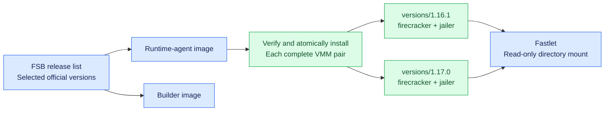
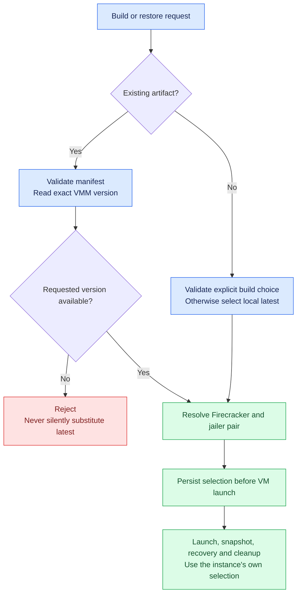

# FSEP-0002: Firecracker Multi-Version Delivery and Selection

## Problem and goals

FSB currently delivers one Firecracker version per runtime-agent image and uses a configured binary path for its sandboxes. Replacing that binary to fix a runtime defect can make existing Full templates and checkpoints unrestorable. The immediate example is RootfsOnly capture: upstream 1.16.1 has a bare Pause/Resume vsock defect that prevents confirmed Guest thaw. Upstream 1.16.2 fixes it, but its Full snapshot format is incompatible with 1.16.0/1.16.1 in both directions ([release notes](https://github.com/firecracker-microvm/firecracker/releases/tag/v1.16.2)).

The goal is to run old and new templates on the same node without silently changing the VMM that owns an instance. FSB should ship selected official releases as needed, choose the version recorded in an existing artifact's manifest, and use the newest locally available supported version when building a new template without an explicit version choice.

This proposal does not introduce a Firecracker fork, automatic tracking of upstream releases, cross-version Full restore, automatic old-version garbage collection, or version-aware cluster scheduling. It does not change the RootfsOnly storage-consistency protocol in [FSEP-0001](0001-rootfs-only-snapshots-overlaybd.md).

## Proposal and tradeoffs

### Delivery: separate immutable version directories

Runtime-agent and Builder images consume one FSB-maintained release list. The initial target is official **1.16.1 and 1.17.0**, subject to the acceptance tests below. Adding a version is an explicit FSB release change, not a request-time download of whichever version upstream currently publishes. The initial implementation skips 1.16.2 and uses 1.17.0, which also includes the upstream vsock fix. Runtime-agent, Fastlet, Builder, and their tools upgrade together; supporting mixed components from different FSB releases is out of scope.

Install each pair under `/opt/fast-sandbox/firecracker/versions/<version>/`, retaining the stable basenames `firecracker` and `jailer`. The installer verifies bundle checksums and both reported versions, stages a complete pair, and atomically publishes the version directory before advertising it as available. Concurrent installation is serialized. Identical installs are idempotent; conflicting contents under an existing version are rejected rather than overwritten. Keep previously installed versions and legacy flat paths during migration.

Fastlet mounts the parent directory read-only. A small installation catalog, or equivalent validated inventory, identifies complete supported releases; arbitrary directories and partially installed releases are not selection candidates. Installation integrity checks remain, but managed capture does not require operators to maintain a separate Firecracker executable SHA256 approval profile. Explicit custom-binary constraints remain additional checks, not a way to bypass runtime capability requirements.

This costs extra image and node disk space, but preserves old artifacts without maintaining a downstream VMM patch. Version-specific directories are preferable to a mutable global `current` link because an image upgrade must not change an existing instance's executable selection.

### Selection: manifest first, local latest only for new builds

| Operation | Selection rule | Failure behavior |
| --- | --- | --- |
| Restore an existing Full template or checkpoint | Exact `compatibility.firecrackerVersion` from its manifest | Missing, unavailable or incompatible version rejects restore |
| Cold-boot an existing RootfsOnly artifact | Exact recorded version in the initial implementation | No automatic cross-version fallback |
| Build a new template with an explicit version or binary | Use the explicit choice after validation | No fallback if it is invalid or unavailable |
| Build a new template without an explicit choice | Newest complete, locally installed, FSB-supported stable release | Fail if there is no eligible release |
| Operate on an existing instance | Its persisted selection, verified against the live process where applicable | Never reselect because another version was installed |

“Newest” uses numeric version ordering within the local supported inventory, not filename ordering or the newest GitHub release. An existing manifest requesting a missing version is not equivalent to a new build without a version. Current manifests require a known Firecracker version; this proposal does not relax that validation. Errors should identify the requested version and available versions.

Use shared selection logic across Builder, `fsb-vm` and Fastlet. In particular, `fsb-vm create --prepare-only` currently validates the manifest before returning its prepared devices. For OCI artifacts, selection must therefore occur after reading the authoritative snapfiles manifest and before that validation; the CLI must return/persist its resolved selection for Fastlet to use. Selecting only after Fastlet's preparation call, or disabling the CLI compatibility check, is insufficient. Other Full artifact paths resolve from their authoritative cached manifest before restore admission. Failed preparation retains the existing attachment cleanup guarantees.

### Lifecycle: bind the choice to the instance

Persist the resolved version, binary path and optional paired jailer path before launching the VMM. Check that the launched process reports the selected version. Snapshot manifests record the VMM and CPU compatibility actually used by that instance; installation of a new version must not alter that provenance.

The selection flows through launch planning, jail setup, snapshot creation, checkpoint restore, restart recovery and deletion. A shared Driver must not temporarily change its global binary path or reuse one cached version for concurrent sandboxes. Startup recovery uses persisted instance state rather than the node's newest release. Cleanup must remain possible even when a selected binary is no longer executable, using recorded resource ownership and paths.

For pre-upgrade instance records without these fields, retain the known legacy configuration and reconcile it with available artifact provenance and the live process identity/version. Backfill only when the mapping is unambiguous; otherwise report an explicit recovery/compatibility problem rather than guessing the newest runtime. Existing manually seeded, manifest-less local caches remain outside managed selection and require the explicit legacy fixed-binary mode until rebuilt with metadata.

## Compatibility

No public Sandbox CRD, gRPC or SDK change is required. Internal runtime configuration must distinguish managed-directory selection from an explicit fixed binary; the resolved profile and Pod mounts must change together. Existing CLI explicit-binary use remains supported. It must not silently override an artifact's recorded version in the managed path. This proposal does not add a controller-level version preference; a build-time explicit choice and the local default are sufficient initially.

The intended initial matrix is:

| Runtime | Full templates/checkpoints | RootfsOnly capture | RootfsOnly cold boot |
| --- | --- | --- | --- |
| Official 1.16.1 | Preserve same-version restore and creation | Reject before Guest freeze because bare Resume breaks vsock | Preserve same-version support |
| Official 1.17.0 | Qualify same-version creation/restore and CPU policy | Enable after the qualified control/storage chain passes | Qualify same-version boot |
| Missing or unsupported version | Reject | Reject | Reject |

Selection and capability are different checks. A matching version or explicit executable digest does not establish a safe RootfsOnly capture path. The interim gate and qualification work in [#185](https://github.com/opensandbox-group/fast-sandbox/pull/185) must recognize managed version directories without weakening the kernel, Guest helper, backend identity or filesystem checks.

Do not rewrite a 1.16.1 Full manifest to claim 1.17.0 compatibility. New 1.17.0 templates must be built using that runtime. Cross-version RootfsOnly cold boot may be considered later, but this proposal does not promise it or depend on capturing a RootfsOnly artifact from an affected stock 1.16.1 source.

CPU-template policy remains version-specific. FSB currently has static-template mappings for 1.16.1; mappings for a new release require review against that upstream release and execution tests. A node/profile must not advertise a CPU tier that is invalid for versions it admits. If their policies differ, restrict the eligible profile or adjust capability reporting before enabling that combination; choosing a different VMM is not a CPU-compatibility workaround.

## Test plan

Each implementation batch receives focused tests and review. Release acceptance must use the actual image-delivered binaries, not an undeclared local patch.

| Layer | Required checks |
| --- | --- |
| Installation and selection | Offline bundled install; paired versions/checksums; interruption and concurrent installation; immutable existing releases; numeric latest selection; missing/invalid manifests and versions; no fallback; custom fixed-binary behavior |
| CLI and lifecycle | Prepare-only and Fastlet agree on selection; concurrent 1.16.1/1.17.0 instances; persisted selection survives Fastlet restart and installation of another release; legacy-state recovery; correct jail and attachment cleanup |
| Builder and Full compatibility | Both object-store and OCI Builder outputs record the actual selected version; each supported version passes its own Full save/restore and checkpoint cycle on supported x86_64 CPUs; wrong-version restore is rejected |
| RootfsOnly integration | A production-built 1.17.0 template passes repeated bare Pause/Resume with fresh vsock connections, capture, confirmed thaw and continued writes, publication and cold boot; then Full capture/restore from the cold-booted instance; direct and jailer launches |
| Negative capability test | Stock 1.16.1 capture is rejected before freeze, including with a correct explicit digest; no artifact is published and the source remains usable |
| Deployment | Actual runtime-agent/Fastlet separate Pods see the same complete read-only release directories; new and legacy templates coexist after rollout |

ARM64 lab runs can supplement these checks but do not replace x86_64 shipped-image acceptance or establish Intel/AMD portability. Cross-vendor RootfsOnly validation remains a separate FSEP-0001 acceptance concern. Until the relevant deployment chain passes, the downstream failure tracked in [#187](https://github.com/opensandbox-group/fast-sandbox/issues/187) is not considered resolved.

## Release delivery

Publish runtime-agent, Fastlet, Builder, and their tools together with the same selected VMM release set. This proposal does not implement or validate compatibility between components from different FSB releases. Missing-version rejection remains the final safety check for an incomplete installation.

Build new templates with 1.17.0 while existing 1.16.1 templates keep using their recorded runtime. Validate the downstream RootfsOnly deployment before enabling production capture. Retain old version directories; automatic garbage collection and automatic VMM substitution are outside this change. Retaining a compatible VMM is necessary for artifact restore, but does not establish that an FSB component downgrade is safe.

Once 1.17.0 Full templates or checkpoints have been produced, downgrading to an FSB release without multi-version selection support is outside the supported boundary. Keeping the 1.17.0 executable on disk does not give an older Fastlet the selection, compatibility checks or persisted-instance handling needed to use it. This applies even when all FSB components are downgraded together; it is separate from the exclusion of mixed-release components above.

If the rollout must be stopped, stop creating new 1.17.0 templates and enabling new RootfsOnly captures while retaining the coordinated multi-version-capable FSB release needed to operate existing instances and restore existing artifacts. Any future supported component downgrade would need separate compatibility validation; this proposal neither implements nor promises it. Relabeling a Full manifest is never a compatibility mechanism.

## Related links

- [#186: RootfsOnly runtime delivery decision](https://github.com/opensandbox-group/fast-sandbox/issues/186).
- [#187: Deployed 1.16.1 thaw failure](https://github.com/opensandbox-group/fast-sandbox/issues/187).
- [#185: RootfsOnly qualification](https://github.com/opensandbox-group/fast-sandbox/pull/185).
- [FSEP-0001: Rootfs-Only Snapshots on the OverlayBD Path](0001-rootfs-only-snapshots-overlaybd.md).
- [Upstream #6100: bare Pause/Resume vsock fix](https://github.com/firecracker-microvm/firecracker/pull/6100) and [1.16.2 release notes](https://github.com/firecracker-microvm/firecracker/releases/tag/v1.16.2).
