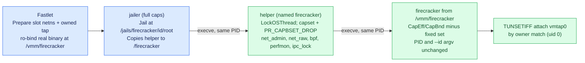

# FSEP-0003: Drop Firecracker VMM Capabilities by Default

## Problem and goals

Every Firecracker VMM runs as uid 0 inside a privileged Fastlet Pod and inherits the Pod's full capability set, including `CAP_NET_ADMIN`, `CAP_NET_RAW`, `CAP_BPF`, `CAP_PERFMON` and `CAP_IPC_LOCK`. The Fastlet network driver prepares each slot namespace completely before launch — it creates the `vmtap0` tap, sets its address and MTU, and installs proxy ARP, NAT and forwarding rules — so the VMM only attaches to the existing tap: `TUNSETIFF`, `TUNSETOFFLOAD` and `TUNSETVNETHDRSZ` are its only tap operations. The VMM neither administers the network nor loads BPF programs, opens perf events, or locks memory, yet a compromised VMM holding these capabilities could administer interfaces and firewalls inside the slot namespace, open raw and packet sockets, or pin unbounded host memory — widening the blast radius of the most exposed process in the trust chain, which parses attacker-influenced state such as checkpoint memory, device data and guest-driven traffic.

The goal is that the Firecracker process starts with a fixed set of capabilities removed from its effective, permitted, inheritable, ambient and bounding sets on the jailer launch path used in production, while the process identity and every observable property the surrounding toolchain depends on — PID, parentage, argv basename, environment, namespaces, cgroup placement, working directory, jail path — remain unchanged. The set is hardcoded in Fastlet-owned code, deliberately not operator-configurable: which privileges a multi-tenant VMM must not hold is a reviewed security decision, and a configuration surface would invite gradual widening. The initial batch is `CAP_NET_ADMIN`, `CAP_NET_RAW`, `CAP_BPF`, `CAP_PERFMON` and `CAP_IPC_LOCK`, and it is explicitly partial bit-level hardening (see below); later batches extend the set through code changes reviewed in this repository.

Out of scope: patching or forking the upstream jailer (an upstream capability flag remains a possible follow-up contribution), running the VMM as a non-root uid (a stronger posture with a larger blast radius across jail-root file ownership, left as future hardening), containerd and Kata runtimes, and the `fsb-vm` builder flow, which keeps its privileges inside its own build Pod.

## Proposal and tradeoffs

### Tap ownership lands first

`GuestVMNetNSDriver.Prepare` creates the tap ownerless today (`ip tuntap add dev vmtap0 mode tap`). On stable kernels through 6.x an unowned persistent tap can be attached by any process that can open `/dev/net/tun`, with no capability check — which is why the capability drop below already works there. The kernel closed this behavior on 2026-11-07 ([CVE-2026-99281](https://git.kernel.org/pub/scm/linux/kernel/git/torvalds/linux.git/commit/?id=ffdf678dd16610e3f006dac904bd37c09684673c), "tun: Require CAP_NET_ADMIN to attach to an ownerless device"): ownerless attach now requires `CAP_NET_ADMIN`, and only an explicit owner or group matching the attaching process exempts it. Distribution kernels including Alibaba Cloud Linux are already tracking the backport. The change therefore sets the tap owner at creation (`ip tuntap add dev vmtap0 mode tap user 0`), so the uid-0 VMM attaches by ownership match on every kernel, old and new — the ownership model the [kernel TUN/TAP documentation](https://docs.kernel.org/networking/tuntap.html) prescribes for separating device configuration from the process that uses it. This change is safe independently of the capability drop and lands as its own PR first.

### A static exec helper at the final exec boundary

The jailer performs all privileged jail setup — joining the slot netns, applying rlimits and cgroups, chroot and pivot_root, `mknod` of `/dev/net/tun`, `/dev/kvm` and `/dev/urandom` — and only then execs the configured `--exec-file` inside the jail. Dropping capabilities before the jailer starts would break that setup, and the upstream jailer (1.16.1 through 1.18.0) offers no capability knob, so the drop must happen between the jail setup and the Firecracker exec. The proposal adds a small statically linked helper (Go, `CGO_ENABLED=0`, syscall-only): read the current capability sets, clear the compiled-in capability set, drop each capability from the bounding set with `PR_CAPBSET_DROP`, set `PR_SET_NO_NEW_PRIVS`, then exec the real binary. Under the execve capability rules for a uid-0 process execing a plain root-owned file, effective = permitted = bounding set, so this is sufficient and no other capability is affected. `PR_CAPBSET_DROP` reports `EINVAL` for capability numbers the running kernel does not define (relevant only for `CAP_BPF`/`CAP_PERFMON` on pre-5.8 kernels) and the helper skips those; every other failure fails the VM create loudly rather than launching with unintended privileges, and a capability being already absent (for example, a future non-privileged Fastlet Pod) is accepted while a real `EPERM` is not.

Linux applies capability sets, `PR_CAPBSET_DROP` and `PR_SET_NO_NEW_PRIVS` to the calling thread, and the execed process inherits the credentials of the surviving thread; `CGO_ENABLED=0` does not make a Go program single-threaded. The helper therefore calls `runtime.LockOSThread()` before its first privilege syscall and keeps the lock until the final `execve`, so every transition and the exec happen on the one thread that received them; a goroutine migration in between would otherwise leave the VMM holding capabilities the helper believed it had dropped.

In jailer mode the Fastlet passes the helper as `--exec-file`, and the helper binary is itself named `firecracker` on the host — installed in its own directory of the Fastlet image (for example `/usr/local/libexec/fast-sandbox/vmm-capdrop/firecracker`) — because the jailer derives the jail root from the exec-file basename (`<chroot-base>/<exec-file-basename>/<id>/root`). Keeping that basename makes the jail path, the in-jail `.pid` file name (`/firecracker.pid`) and every Fastlet path consumer exactly what they are today, with no migration or adoption change for pre-change jails. The jailer copies the helper into the jail root as `/firecracker` (a fresh file per launch). The Fastlet places the selected real binary in the jail separately: bind-mounted read-only at `/vmm/firecracker` in the OCI restore and RootfsOnly cold-boot paths (the existing pattern for rootfs and kernel), reflink-or-copied in the snapshot-restore path (the existing `prepareJailRoot` pattern). Jail teardown must unmount this bind together with the existing snapshot-spill unmount before removing the jail directory, or the recursive removal fails on the busy mount. The helper execs `/vmm/firecracker`, forwarding argv unchanged: the jailer's post-`--` arguments (`--api-sock`, `--log-path`) and its fixed prefix (`--id`, start-time flags) are all Firecracker arguments and pass through untouched, and the exec path keeps the `firecracker` basename that NodeJanitor matches. The fixed convention is forced by the jailer interface, which clears the environment and owns argv, leaving no channel to name the target; in the legacy direct-launch mode the Fastlet controls argv and passes the target path to the helper explicitly.

Three jailer behaviors shape the design. The exec-file copy uses a truncating create, so the real binary must never occupy the `/firecracker` path inside the jail — a read-only bind mount there would fail the jailer loudly, and a writable one would let the copy write through the mount and corrupt the managed host binary; hence the `/vmm/firecracker` placement. The jailer rejects a copy destination with more than one hard link; this is satisfied because the helper copy destination is fresh per launch and bind mounts add no link. And the final process must keep basename `firecracker` with `--id` in argv because NodeJanitor matches residual VMMs that way (`cmdline` only; `comm` and `/proc/<pid>/exe` are not consulted by the matcher, and `exe` still resolves to the real binary's contents for managed-capture qualification). Because jailer → helper → Firecracker is one execve chain in one process, PID, parentage, environment, cgroup, namespaces and working directory are unchanged.

The alternatives were considered and deferred. Naming the helper `fsvm-exec` would require migrating Fastlet's jail-root derivation to `<base>/fsvm-exec/<id>/root`, plus adoption and cleanup of pre-change jails and compatibility for discovery-record readers — rejected as pure migration cost. A patched jailer with a capability flag is the cleaner long-term shape and a plausible upstream contribution — upstream's own jailer documentation notes it "actually requires a more restricted set of capabilities, but that's to be determined" — but it means maintaining a security-critical fork in the interim. Running the VMM as a non-root uid drops all capabilities but changes ownership semantics for every jail-root file the VMM touches. File capabilities on the jail copy do not survive the jailer's `fs::copy`, and `setpriv` cannot be copied into the glibc-free jail. The helper keeps the change inside Fastlet-owned code and is Firecracker-version-agnostic: one helper serves the whole managed 1.16.1/1.17.0 inventory from [FSEP-0002](0002-firecracker-multi-version-delivery.md) as well as fixed-binary deployments, and it lives in the Fastlet image rather than the managed versions directory, so the paired-binary verification contract and version selection are untouched.

The dropped set is justified per capability, and the first batch is explicitly partial bit-level hardening. The VMM attaches to a pre-configured tap and performs no interface, firewall, raw-socket or packet-socket operation (`net_admin`, `net_raw`). It calls no `mlock`-family API (`ipc_lock`): the only `mlock` mention in the Firecracker source is an abandoned TODO comment beside the `mincore`-based dirty-page approximation for diff snapshots, and since root's `mlock` bypasses `RLIMIT_MEMLOCK`, removing the capability is the only bound on a compromised VMM pinning unbounded host memory. It loads no BPF programs and opens no perf events, but clearing `bpf`/`perfmon` does not by itself deny those operations, because the kernel evaluates `bpf_capable()` and `perfmon_capable()` as `CAP_BPF || CAP_SYS_ADMIN` and `CAP_PERFMON || CAP_SYS_ADMIN`; with `sys_admin` retained in this batch, operation-level denial of BPF and perf relies on Firecracker's default, mandatory seccomp allowlist, and implementation must verify that `bpf(2)` and `perf_event_open` are absent from the generated policy. A later batch removes `sys_admin` to make that denial cap-complete. Later batches extend the set toward the end state of an empty bounding set — the VMM holds no capabilities by design, its authority being uid 0 plus the chroot and netns boundaries — and every addition carries the same evidence bar and a code review.

## Compatibility

This is a deliberate behavior change on merge, with no configuration to fall back to — that is the point of hardcoding — so it needs explicit maintainer agreement here. There is no public API, CRD, SDK, CLI or storage-format change: the capability set lives in Fastlet code and the helper. Existing Sandboxes, templates, snapshots and checkpoints are unaffected: the VMM sees the same binary content, forwarded arguments, environment, fds and working directory as before — the only argv difference is the exec path prefix (`/vmm/firecracker` instead of `/firecracker`), which keeps the `firecracker` basename every consumer matches on — so artifacts built or captured before the change restore identically.

Fastlet and runtime-agent images upgrade together per the FSEP-0002 convention. During a staged rollout, mixed Fastlet versions across nodes produce mixed capability states per node while VMs on one node are homogeneous; this is safe because a running VMM's capabilities are process state and never part of persisted records — a VM restored or re-adopted by a Fastlet of the other version keeps whatever it was launched with. The helper is compatible with both managed Firecracker versions and fixed-binary deployments, and because the jail path is unchanged, recovery adoption and cleanup of pre-change instances need no special handling. Kernel-side, tap ownership and attach semantics were verified against 5.10, 6.1 and 6.12 source and the post-CVE semantics; `PR_CAPBSET_DROP` and `PR_SET_NO_NEW_PRIVS` are available on all supported kernels.

Process-contract invariants were audited against their consumers: NodeJanitor residual matching (cmdline basename plus `--id`), restart recovery's `/proc` scans and managed-capture qualification (content comparison of the host binary against `/proc/<pid>/exe`, which now resolves to the read-only bind of the managed binary) are unchanged. The guest-visible `/proc/<pid>/exe` path differs from today (the bind target rather than a jailer-made copy), which no FSB consumer reads; the in-jail `.pid` file keeps its `/firecracker.pid` name.

## Test plan

Unit tests: helper argv forwarding, capability clearing over the fixed set including the unknown-capability skip and the loud-`EPERM` path, self-verification that all promised sets lack the dropped bits, and the locked-thread contract (privilege transitions and exec on one thread); launcher argv for jailer and direct modes with the helper inserted; jail-root contents asserting that `/firecracker` is the helper copy and `/vmm/firecracker` is a read-only bind or content-identical copy of the selected managed binary with no hard links; the tap creation command gaining the owner argument; the generated Firecracker seccomp policy containing neither `bpf(2)` nor `perf_event_open` (the operation-level denial this batch relies on).

Launch-time assertion: after every Firecracker create, read `/proc/<pid>/status` and require the fixed set absent from `CapEff` and `CapBnd` and `NoNewPrivs` equal to 1, unconditionally; include the result in create diagnostics for supportability. The assertion proves the bits are absent; operation-level denial of BPF/perf is established by the seccomp policy check above and the kernel semantics once `sys_admin` is removed in a later batch.

E2E on the Firecracker runtime environment: cold boot (RootfsOnly), Full restore, guest-control round trip, actions, egress pool, the chain-e2e host→guest network path, managed capture, restart recovery after a Fastlet crash, and a NodeJanitor leak sweep.

Compatibility matrix: new Fastlet version × managed 1.16.1 / 1.17.0 × fixed-binary mode, including a node hosting 1.16.1 and 1.17.0 sandboxes concurrently (the helper is version-agnostic and the jail path is keyed by sandbox id, not version), plus restore of artifacts created before the change and re-adoption of a pre-change VMM by a post-change Fastlet (and the reverse during rollback). Performance: launch latency measured against the chain-e2e harness baseline (jailer spawn ≈ 20 ms) on the same host and cache state; acceptance is within run-to-run noise. Acceptance criteria: every VMM shows the fixed set absent from `CapEff` and `CapBnd` with `NoNewPrivs=1`, the seccomp policy check passes, and all existing suites pass.

## Rollout and rollback

PR order: first the tap-owner change (safe independently, keeps the slot namespace free of the ownerless-attach exposure), then the helper and launcher change with the drop always on. Staged rollout rides the Fastlet image rollout: canary nodes via scheduling labels first, then fleet; a pool adopts the change as its nodes receive the image, so blast radius is controlled by rollout pace rather than configuration.

Rollback is a Fastlet image rollback: newly created VMs regain the capabilities, already-running VMMs are unaffected in either direction because capability state is per-process and nothing is persisted — there is no data or snapshot migration. The tap-owner change deliberately stays in place after rollback: it is harmless without the drop and remains correct once the kernel backport lands. Signals to monitor during rollout: sandbox create failure rate, API socket readiness latency and launch duration histogram, first-request stall after restore (guest networking), egress interception success, and NodeJanitor cleanup counts. Limitation: if a future upstream Firecracker feature turns out to require one of the dropped capabilities, image rollback is the immediate mitigation and a code change extends or re-scopes the set.

## Related links

- Kernel: [CVE-2026-99281 commit](https://git.kernel.org/pub/scm/linux/kernel/git/torvalds/linux.git/commit/?id=ffdf678dd16610e3f006dac904bd37c09684673c) and the [TUN/TAP driver documentation](https://docs.kernel.org/networking/tuntap.html) (ownership model for persistent taps).
- Upstream Firecracker: [jailer documentation](https://github.com/firecracker-microvm/firecracker/blob/main/docs/jailer.md) acknowledging an undetermined restricted capability set; no capability feature exists in the jailer through v1.18.0.
- [FSEP-0002](0002-firecracker-multi-version-delivery.md): managed Firecracker delivery and selection, which governs the Fastlet/runtime-agent image coupling and the versions-directory contract the helper deliberately stays out of.
