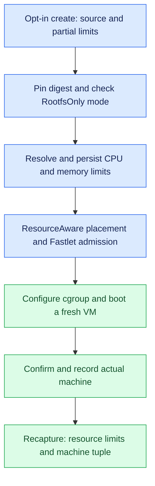

# FSEP-0005: CPU and Memory Overrides for Rootfs-Only Sandbox Creation

## Problem and goals

A RootfsOnly Sandbox boots a new kernel from a captured filesystem. Today the [cold-boot builder](../internal/firecrackerconfig/rootfs.go) configures the VM from the source manifest's vCPU and memory tuple. Restore checks can reject a smaller caller limit; a larger limit alone does not enlarge the VM. This proposal lets a ResourceAware pool admit and boot the same RootfsOnly artifact at caller-selected CPU and memory limits, and preserve the result across retries and snapshots.

The companion [OSEP-0028, CPU and Memory Overrides for Rootfs-Only Sandbox Creation](https://github.com/opensandbox-group/OpenSandbox/blob/main/oseps/0028-rootfs-only-create-overrides.md) owns the public API, SDK defaults and HTTP compatibility. This FSEP owns source resolution, resource admission, boot and snapshot metadata. Business entrypoint overrides are a future candidate and require a separate decision about guest initialization. CPU and memory overrides need no guest helper upgrade.

## Proposal and tradeoffs

### Distinguish resource limits from VM configuration

| Value | Example | Owner and purpose |
|---|---|---|
| Snapshot defaults | `500m / 2Gi` | The source Sandbox's admitted CPU and memory limits (projected into OpenSandbox's `SnapshotRestoreConfig.limits`) supply omitted dimensions. Preserve fractional CPU across recapture. |
| Catalog template defaults | `2 cores / 2Gi` | The effective build-time machine tuple (projected into `spec_json.machine`) supplies omitted dimensions. Each whole vCPU represents one default core. A caller can supply a fractional quota at creation. |
| Effective limits | `500m / 4Gi` after a memory-only override | The FSB control plane resolves and persists this pair. ResourceAware placement and admission derive requests from it under pool policy. |
| Boot machine | `1 vCPU / 4096 MiB` | The driver configures Firecracker before start. Full snapshot metadata must describe this actual machine. |

The two representations cannot be reconstructed from one another: both `500m` and `1` produce one vCPU. Store the effective resource limits and actual machine tuple in the instance record. On recapture, preserve the resource pair as typed, optional artifact metadata alongside the machine tuple and project it into source lookup metadata bound to the published digest. The pair must travel with the artifact so a fresh consumer can recover it. Preserve original lineage and leave the parent artifact immutable. Before release, verify backward decoding of the additive artifact fields or version the format and gate incompatible readers.

### Create, admit and boot

1. OpenSandbox authorizes the public source and forwards its immutable identity plus the **supplied dimensions** via typed gRPC. FSB interprets manifests through its storage adapters. It can project builder/runtime metadata into source status; OSB needs neither direct manifest access nor a second resolution algorithm. Pin the artifact before placement. An explicit override requires positive RootfsOnly identification; Full, missing mode or unsupported backend fails before launch.
2. Prefer a distinct FastPath create RPC sharing existing create implementation. Older controllers then return `UNIMPLEMENTED`. Do not retry through ordinary Create. Carry an explicit required capability through assignment and dispatch; presence of legacy `resources.limits` is ambiguous. Only place on workers qualified for this operation. The selected worker must enforce the required operation before side effects; use versioned dispatch or restrict the entire enabled pool to a qualified rollout revision. Ordinary mixed-version scheduling alone is insufficient.
3. For each omitted dimension, use the default for the authorized source kind from the table above. A legacy snapshot missing that dimension requires an explicit caller value; a complete pair allows that snapshot to proceed through the other eligibility checks. Older catalog templates use their existing build-default derivation. An invalid effective build tuple is a catalog invariant failure. Validate quantities against the pool and VMM bounds. For v1, require memory to represent a positive whole MiB and use existing positive CPU quantity rules including the ResourceAware minimum. Convert CPU to whole vCPUs by ceiling, with the fractional CPU quota enforced by the host.
4. Persist the canonical override intent, pinned digest and effective pair. Share [ResourceAware admission](../internal/controlplane/orchestrator/orchestrator.go) for requests, capacity and limits; reject LegacySlot overrides. A retry for the same request reuses its persisted result. A change to the digest or canonical intent under the same request identity is a conflict.
5. In the driver, verify the actual digest/mode again and pass the resolved machine into the shared cold-boot builder. Apply it before `InstanceStart`. Leave existing Full compatibility checks, ordinary creates and CLI calls without override intent on their current paths. Persist the intended machine before launch. Confirm it against the launched VM before marking the override create ready; recovery reconciles a started VM against that persisted intent. A mismatch or failed startup cannot produce a successful smaller/default VM.

### ResourceAware memory accounting

Follow the [direct Firecracker cgroup model](../docs/concepts/runtimes.md). The configured guest RAM is a machine parameter. The per-Sandbox leaf uses `memory.max=max`; resident guest pages and VMM overhead consume the shared subtree capped at `sandboxRuntimeBudget`. The per-Pod Fastlet overhead reserve is separate. Keep this accounting model for overrides. Apply the effective CPU limit as the leaf quota and the derived CPU request as its scheduling weight. Do not deduct a second per-VM overhead allowance from requested guest RAM. A smaller guest can still fail application startup.

### Snapshot writers and recovery

Both the RootfsOnly writer and [Full manifest assembly](../internal/runtime/firecracker/snapshot_driver.go) must use authoritative instance state for new captures. For example, a source admitted at `500m / 2Gi` yields a new VM at `500m / 4Gi` after a memory-only override. Its new RootfsOnly artifact carries limits `500m / 4Gi` and machine `1 / 4096 MiB`. A later memory-only create still receives a half-core quota. A Full checkpoint records the same actual machine and resumes the captured VM using existing Full rules. Retain the resource metadata separately for accounting. If an override-created instance loses its required state, fail capture or reconcile it from authoritative persisted data before publishing. Reading its parent manifest as a fallback can mislabel a Full checkpoint.

## Compatibility

Scope is resource-only creation from qualified RootfsOnly artifacts. Existing kernel, architecture, device, networking and VMM compatibility checks remain in force. Gate support by the actual pool/worker revision and storage path. OCI/OverlayBD can qualify independently; native/S3 additionally requires [PR #181](https://github.com/opensandbox-group/fast-sandbox/pull/181) or equivalent delivery support. Each enabled path must pass the same contract. Keep both disabled for unknown revisions. No change to Firecracker itself, guest init, or public entrypoint behavior is needed.

## Test plan

| Exercise | Pass criteria |
|---|---|
| Resolve and replay | CPU-only, memory-only and complete pairs; reject invalid quantities, missing inherited dimensions, Full source and stale digest. Changed intent on retry conflicts. Identical retries produce one creation. |
| Mixed versions | Old gRPC controller rejects the opt-in operation. An eligible pool with an unqualified or replaced Fastlet cannot dispatch the override to that worker. No legacy create fallback. |
| KVM growth and shrink | Boot qualified 1-vCPU/1-GiB and 4-vCPU/4-GiB instances from the same source. Compare VMM configuration and guest online CPUs. Allow for kernel reservations in guest MemTotal. Check CPU quota, shared memory ceiling, unlimited leaf memory and admission demand. |
| Fractional CPU round trip | Create at `500m`, publish RootfsOnly, clear consumer cache and override only memory. Verify the successor's leaf still enforces `500m` and its guest sees one vCPU. Capture a Full checkpoint and restore the actual new machine. |
| Recovery and rejection | Restart Fastlet between VMM start and readiness, then again before recapture. Verify reconciliation or explicit failure, accurate published metadata and no leaked capacity. A budget rejection launches no VM. |
| Delivery | Run on disposable Linux/KVM with OCI/OverlayBD, then native/S3 before enabling that path. Compare ordinary Full restores and ordinary RootfsOnly creates as regressions. |

## Rollout and rollback

Keep admission disabled while shipping the metadata reader/writer, override-aware control plane and workers. Enable an isolated ResourceAware pool after qualifying the storage backend and worker revision. Monitor rejected creates, effective versus actual machine shape, cgroup quota and memory pressure, and fresh-consumer recapture/restore results. On a mismatch, disable new overrides and keep compatible workers available for existing instances, retries and snapshots until drained. Do not downgrade a writer that could publish inherited parent settings for an override-created instance.

Review decisions before implementation are the additive artifact metadata representation, the gRPC operation and worker gate, and backward-reader behavior. Their acceptance tests above define the required outcomes.
