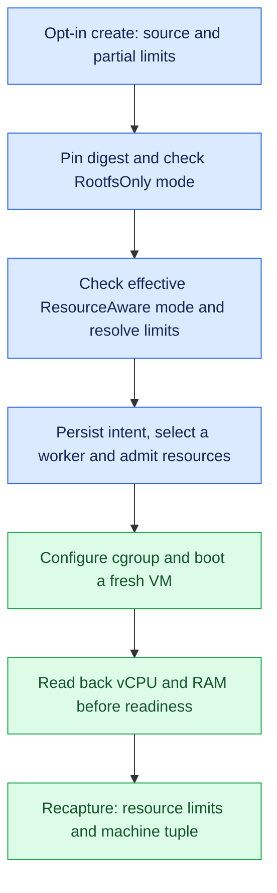

# FSEP-0005: CPU and Memory Overrides for Rootfs-Only Sandbox Creation

## Problem and goals

A RootfsOnly Sandbox boots a new kernel from a captured filesystem. Today the [cold-boot builder](../internal/firecrackerconfig/rootfs.go) configures the VM from the source manifest's vCPU and memory tuple. Restore checks can reject a smaller caller limit; a larger limit alone does not enlarge the VM. This proposal lets a ResourceAware pool admit and boot the same RootfsOnly artifact at caller-selected CPU and memory limits, and preserve the result across retries and snapshots.

The companion [OSEP-0028, CPU and Memory Overrides for Rootfs-Only Sandbox Creation](https://github.com/opensandbox-group/OpenSandbox/blob/main/oseps/0028-rootfs-only-create-overrides.md) owns the public API, SDK defaults and HTTP compatibility. This FSEP owns source resolution, resource admission, boot and snapshot metadata. Business entrypoint overrides are a future candidate and require a separate decision about guest initialization. CPU and memory overrides need no guest helper upgrade.

## Proposal and tradeoffs

### Distinguish resource limits from VM configuration

| Value | Example | Owner and purpose |
|---|---|---|
| Snapshot defaults | `500m / 2Gi` | The source Sandbox's admitted CPU and memory limits (projected into OpenSandbox's `SnapshotRestoreConfig.limits`) supply omitted dimensions. Preserve fractional CPU across recapture. |
| Catalog template defaults | `2 cores / 2Gi` | The effective build-time machine tuple (projected into `spec_json.machine`) supplies omitted dimensions. Each whole vCPU represents one default core. A caller can supply a fractional quota at creation. |
| Effective limits | `500m / 4Gi` after a memory-only override | The FSB control plane resolves and persists this pair. ResourceAware placement and admission derive requests from it under pool policy. |
| Boot machine | `1 vCPU / 4096 MiB` | The driver configures Firecracker before start. Full snapshot metadata must describe this actual machine. |

The two representations cannot be reconstructed from one another: both `500m` and `1` produce one vCPU. Store the effective resource limits and actual machine tuple in the instance record. On recapture, preserve the resource pair as typed, optional artifact metadata alongside the machine tuple and project it into source lookup metadata bound to the published digest. The pair must travel with the artifact so a fresh consumer can recover it. Preserve original lineage and leave the parent artifact immutable. Before release, verify backward decoding of the additive artifact fields or version the format and gate incompatible readers.

### Create, admit and boot

1. OpenSandbox authorizes the public source. The create RPC identifies the source kind (`snapshotId` or `templateId`) and its authorized namespaced reference, and carries the CPU and memory dimensions present on the wire. For snapshots, the gateway also sends the available `SnapshotRestoreConfig.limits` as separate source defaults associated with that snapshot. FSB resolves the reference to its immutable artifact digest and verifies RootfsOnly mode before placement. An older snapshot can inherit a recorded `500m` even when its manifest predates the limits metadata. For catalog templates, FSB uses the effective machine on the authorized template CR; OpenSandbox's `spec_json.machine` records the same build tuple under OSEP-0026. An invalid effective tuple is a catalog/build invariant error. OSB has no need to read a manifest.
2. Prefer a distinct FastPath create RPC sharing existing create implementation. Older controllers then return `UNIMPLEMENTED`. Do not retry through ordinary Create. Carry an explicit required capability through assignment and dispatch; presence of legacy `resources.limits` is ambiguous. Only place on workers qualified for this operation. The selected worker must enforce the required operation before side effects; use versioned dispatch or restrict the entire enabled pool to a qualified rollout revision. Ordinary mixed-version scheduling alone is insufficient.
3. For each omitted dimension, use the default for the authorized source kind from the table above. A legacy snapshot missing that dimension requires an explicit caller value; a complete pair allows that snapshot to proceed through the other eligibility checks. Older catalog templates use their existing build-default derivation. An invalid effective build tuple is a catalog invariant failure. Validate quantities against the pool and VMM bounds. For v1, require memory to represent a positive whole MiB and use existing positive CPU quantity rules including the ResourceAware minimum. Convert CPU to whole vCPUs by ceiling, with the fractional CPU quota enforced by the host.
4. Check the **effective** placement mode before persisting create intent or dispatching to a Fastlet. Use the same mode decision as the [orchestrator](../internal/controlplane/orchestrator/orchestrator.go): `DisableResourceAwarePlacement` makes a declared ResourceAware pool effectively LegacySlot. Reject both declared and effective LegacySlot pools. After admission checks, persist the canonical override intent, pinned digest and effective limits. A retry reuses that identity; changed intent or digest is a conflict.
5. Verify the artifact identity and mode in the driver. For a verified override create on either native/S3 or OCI/OverlayBD, replace the source-machine minimum-size check with the admitted CPU/memory bounds from step 3. This permits a smaller fresh guest. Ordinary creates and Full restores retain their existing restore checks. Keep kernel, architecture, device and VMM compatibility checks on both backends.

6. Persist the intended machine before launch and apply it before `InstanceStart`. Once the VMM reports Running, read `GET /machine-config` through the instance's Firecracker API socket (including the jailer socket layout). The client must support this read in addition to `ConfigureMachine`. Compare `vcpu_count` and `mem_size_mib` with the persisted intent before reporting readiness. A read failure or mismatch fails creation and triggers cleanup; an interrupted start must reconcile or fail before adoption.

### ResourceAware memory accounting

Follow the [direct Firecracker cgroup model](../docs/concepts/runtimes.md). The configured guest RAM is a machine parameter. The per-Sandbox leaf uses `memory.max=max`; resident guest pages and VMM overhead consume the shared subtree capped at `sandboxRuntimeBudget`. The per-Pod Fastlet overhead reserve is separate. Keep this accounting model for overrides. Apply the effective CPU limit as the leaf quota and the derived CPU request as its scheduling weight. Do not deduct a second per-VM overhead allowance from requested guest RAM. A smaller guest can still fail application startup.

### Snapshot writers and recovery

A RootfsOnly recapture records both the guest machine tuple and the instance's admitted limits. A `500m / 4Gi` instance publishes `1 vCPU / 4096 MiB` and `500m / 4Gi`. A later memory-only override inherits `500m`. The [Full snapshot writer](../internal/runtime/firecracker/snapshot_driver.go) must likewise record the captured machine and keep any known resource limits separately.

Managed Full resume restores vCPU and RAM from vmstate. The host CPU quota comes from the resource admission of the resumed Sandbox. When its durable Sandbox spec still carries `500m`, the required outcome is a `500m` leaf quota, and a later RootfsOnly recapture must record that actual admitted limit. This round trip requires validation. A standalone legacy Full artifact with only `1 vCPU` cannot establish whether the previous quota was `500m` or one core. Existing Full rules determine the new admission; recapture records the resulting quota. If the actual machine or required runtime state of an override-created instance cannot be recovered, fail capture before publication.

## Compatibility

Scope is resource-only creation from qualified RootfsOnly artifacts. Existing kernel, architecture, device, networking and VMM compatibility checks remain in force. Gate support by the actual pool/worker revision and storage path. OCI/OverlayBD can qualify independently; native/S3 additionally requires [PR #181](https://github.com/opensandbox-group/fast-sandbox/pull/181) or equivalent delivery support. Each enabled path must pass the same contract. Keep both disabled for unknown revisions. No change to Firecracker itself, guest init, or public entrypoint behavior is needed.

## Test plan

| Exercise | Pass criteria |
|---|---|
| Resolve and replay | CPU-only, memory-only and complete pairs; reject invalid quantities, missing inherited dimensions, Full source and stale digest. Changed intent on retry conflicts. Identical retries produce one creation. |
| Mixed versions | Old gRPC controller rejects the opt-in operation. An eligible pool with an unqualified or replaced Fastlet cannot dispatch the override to that worker. No legacy create fallback. |
| Effective mode | Set `DisableResourceAwarePlacement` on a declared ResourceAware pool. Override admission rejects before creating a Sandbox CR or invoking a Fastlet. |
| KVM growth and shrink | Exercise native/S3 and OCI/OverlayBD. Overrides can shrink below the source shape; ordinary and Full restore paths retain their former validation. For direct and jailer launches check the machine-config read-back, guest online CPUs and memory, CPU quota and placement accounting. Inject an unreadable or mismatched VMM response and verify failed creation and cleanup. |
| Fractional CPU round trip | From a `500m` instance, recapture RootfsOnly and override only memory on a fresh consumer. Separately, take a Full checkpoint, resume the same managed Sandbox, then recapture RootfsOnly. In both chains check one guest vCPU, a `500m` host quota and `500m` in the new artifact. For a standalone legacy Full without quota metadata, assert that recapture records the newly admitted quota. |
| Recovery and rejection | Restart Fastlet between VMM start and readiness, then again before recapture. Verify reconciliation or explicit failure, accurate published metadata and no leaked capacity. A budget rejection launches no VM. |
| Delivery | Run on disposable Linux/KVM with OCI/OverlayBD, then native/S3 before enabling that path. Compare ordinary Full restores and ordinary RootfsOnly creates as regressions. |

## Rollout and rollback

Keep admission disabled while shipping the metadata reader/writer, override-aware control plane and workers. Enable an isolated ResourceAware pool after qualifying the storage backend and worker revision. Monitor rejected creates, effective versus actual machine shape, cgroup quota and memory pressure, and fresh-consumer recapture/restore results. On a mismatch, disable new overrides and keep compatible workers available for existing instances, retries and snapshots until drained. Do not downgrade a writer that could publish inherited parent settings for an override-created instance.

Review decisions before implementation are the snapshot-defaults handoff and template CR authority in step 1, the additive artifact metadata representation, the gRPC operation and worker gate, and backward-reader behavior. Their acceptance tests above define the required outcomes.
