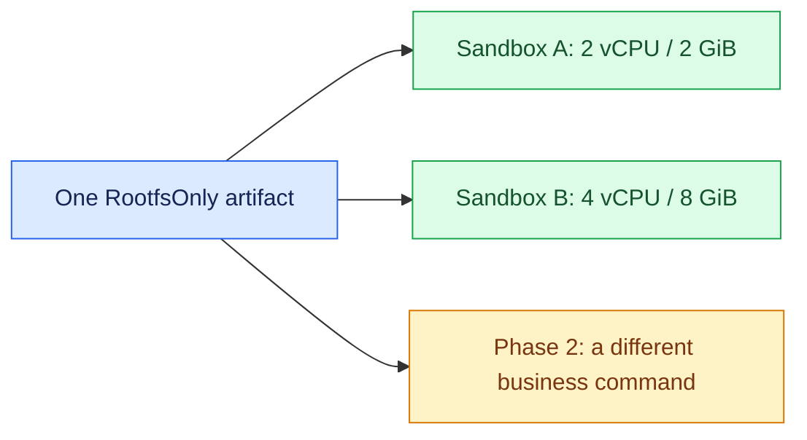
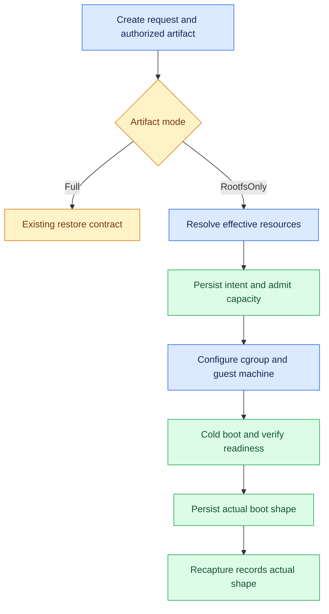
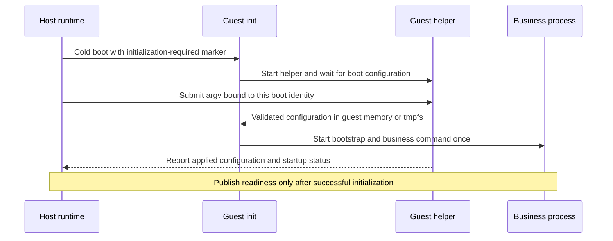

# FSEP-0005: Rootfs-Only Sandbox Creation Overrides

## Problem and goals

A RootfsOnly snapshot preserves a filesystem and boot metadata, but no RAM or running vCPU state. It can therefore boot a new Sandbox with different CPU and memory settings. Today, the shared cold-boot configuration still takes `vcpu_count` and `mem_size_mib` from the source manifest, and restore validation rejects requests smaller than that source. A larger admitted limit does not itself enlarge the guest. The business entrypoint is also baked into the guest startup environment.

Allow the same RootfsOnly artifact to create differently sized Sandboxes without rebuilding its filesystem. Phase 1 covers CPU and memory at creation. Phase 2 covers an optional business entrypoint override using an explicit guest initialization contract. This proposal does not implement live resizing, change Full snapshot restoration, replace guest PID 1, or make an artifact portable across CPU architectures.

## Proposal and tradeoffs

### Scope and source identity

| Operation | Proposed behavior |
|---|---|
| Create from RootfsOnly with explicit CPU/memory overrides | Boot a new guest using the admitted effective specification |
| Create from RootfsOnly without overrides | Preserve the existing caller-visible defaults and behavior |
| Create from Full or resume a checkpoint | Keep existing compatibility and resource rules; no new override permission |
| Change a running Sandbox | Outside this proposal |
| Override the business entrypoint | Phase 2, only for templates declaring the new initialization capability |

Resolve the caller's authorized snapshot or template to an immutable artifact identity before interpreting overrides. Use its trusted manifest `platform.snapshotMode`; do not trust a user-provided mode, registry tag naming convention, or storage type. Treat a missing mode using existing Full semantics. Authorization, resource validation, and mode checks must finish before a new guest starts.

The FSB implementation covers both OCI/OverlayBD and native/S3 RootfsOnly artifacts through the shared cold-boot configuration. Native/S3 end-to-end acceptance depends on [PR #181](https://github.com/opensandbox-group/fast-sandbox/pull/181); the resource override concept and OCI implementation do not. Guest clock synchronization in [PR #218](https://github.com/opensandbox-group/fast-sandbox/pull/218) shares a transport but is not a prerequisite for Phase 1.

### Phase 1: resolve resources once, use them throughout creation

OpenSandbox resolves its public request into an effective resource pair: explicit fields override the source defaults, and omitted fields retain the existing defaults for that creation route. For snapshot/template routes that currently inherit source resources, inherit the corresponding source value. Do not silently change direct FSB clients from pool defaults to template defaults. Document defaulting at each public entry point; SDK-injected defaults count as supplied values unless the SDK preserves omission explicitly.

The runtime must distinguish an intentional boot-shape override from limits populated by existing defaulting. Presence of `resources.limits` alone is insufficient because existing template routes already send that field. Preserve this distinction in persisted creation intent; the precise additive protocol representation must be agreed during implementation review, with absence selecting legacy behavior.

Reuse FastPath `resources.limits` and the existing ResourceAware pool admission model for supported overrides. LegacySlot pools continue rejecting unsupported per-Sandbox overrides. The control plane must persist the effective resources and immutable source identity before dispatch, and placement, Fastlet admission, cgroup configuration, and guest configuration must agree. Reject requests beyond the pool/runtime budget before launching the VMM.

The driver must distinguish admitted host limits from the guest machine shape. CPU quantities may be fractional: use the existing ceiling convention for vCPU count and preserve the admitted CPU quota (for example, `500m` means one vCPU with a half-core quota). Validate Firecracker's vCPU bounds and supported topology before side effects. Memory must be positive and representable in MiB; normalization must not allocate guest RAM above the admitted budget through unchecked rounding.

Before enabling overrides, verify how the existing runtime budget accounts for VMM memory overhead. A cgroup limit equal to guest RAM can leave insufficient room for the VMM. The implementation must retain a documented overhead allowance or reject configurations that cannot fit, and must not silently reduce the requested guest RAM to make admission succeed. This is an implementation qualification requirement, not a claim that the current resource contract already solves the overhead problem.

Pass an explicit effective machine configuration into the shared cold-boot builder used by Driver and CLI, rather than modifying the cached source manifest. Existing CLI calls without override arguments retain manifest defaults; adding CLI override flags is optional and must use the same validation. Apply `/machine-config` before `InstanceStart`. Full restore must continue loading its original machine state instead of entering this path.

Persist the actual booted CPU/memory tuple separately from source provenance. A later Full snapshot or checkpoint must describe the machine actually captured; a later RootfsOnly snapshot should record that actual tuple as its next default. Current Full manifest assembly inherits source machine fields, so updating only cold boot would leave incorrect metadata after recapture. Preserve the original source digest for lineage and do not rewrite shared artifacts.

Creation retries and Fastlet recovery must reuse the persisted effective shape. A retry with conflicting resources is rejected under the existing request identity rules. Never silently fall back to the old shape when an override fails. A smaller guest may fail application startup even when Firecracker accepts it; report the startup failure and clean up resources normally.

### Phase 2: apply the business entrypoint before it can run

Changing a manifest entrypoint alone does not change the current boot behavior. The Builder writes `ENTRYPOINT` into `/etc/sandbox-init.env`, and guest init sources that file before launching bootstrap. Firecracker does not interpret the business command itself.

| Approach | Benefit | Cost |
|---|---|---|
| Edit the instance-private rootfs before boot | Can support some existing template layouts | Requires host-side guest filesystem access and separate native/OverlayBD handling; must never alter shared source data |
| Deliver configuration over vsock before business startup | One control path for both storage backends; avoids host filesystem editing | Requires a new helper/init capability and a bounded startup handshake |

Prefer a versioned initialization handshake over the existing host-authenticated guest-control vsock transport. This is a new method and startup contract, not a reuse of freeze operation generations and not an arbitrary command-execution API. Define exact wire fields in the Phase 2 implementation review after a small boot-ordering PoC.

The boot marker must be available before init decides whether to launch the baked command. It must not contain the user command or secrets. Updated init may follow the legacy path when no override marker is present. With the marker present, missing configuration, an unsupported helper, or a timeout fails startup instead of running the old entrypoint as a fallback.

Minimum protocol requirements:

- Bind the request to the current guest boot and admitted Sandbox incarnation; authenticate the host and bound frame size and deadline.
- Carry the command as an argv array. Preserve argument boundaries; never evaluate a host-provided shell fragment implicitly. An explicitly requested shell remains a user command.
- Repeating the same boot configuration returns the existing result; a conflicting configuration is rejected. Lost acknowledgements require a status query, not a second process launch.
- Cancellation or expiry is terminal for that boot operation. A late request must not start a workload after host cleanup has begun. Host cancellation must stop the failed VM when the outcome cannot be established.
- Keep PID 1, mount setup, helper, platform bootstrap, and required execd services under platform ownership. An entrypoint override changes only the business command.
- Persist the effective entrypoint in runtime intent. Subsequent RootfsOnly creation without a new override must be able to reproduce it: carry it into the new artifact and deliver it on cold boot using the same capability, rather than leaving only a stale baked default. Full resume continues the captured process state and must not rerun initialization.

A helper capable only of freeze/thaw or settime does not prove initialization support. Templates must explicitly declare the capability, and the host must verify the live helper before claiming success. No entrypoint override is enabled for legacy templates without a compatible init, even if a helper binary has been replaced.

### OpenSandbox integration and ownership

This FSEP owns FSB runtime behavior and its internal delivery contract. An OpenSandbox OSEP should define the public API behavior and SDK defaulting; this document does not independently approve changes to that repository.

The OpenSandbox snapshot mapping currently compares requested limits with recorded source limits, while template creation rejects `resourceLimits` and `entrypoint` in the request schema. Permit these fields only after resolving a RootfsOnly source and the target runtime capability. Structural request validation must not reject potentially valid overrides before source resolution; semantic checks must still reject unsupported Full/template combinations explicitly.

Reuse existing public fields where possible. Do not add a new public endpoint simply to resize a cold boot. Preserve tenant checks, source readiness, pool selection, and existing behavior for Docker, other runtimes, and requests without overrides. Publish the resolved effective settings in Sandbox metadata so users can distinguish a requested override from an inherited default.

| Area | Planned work |
|---|---|
| OpenSandbox schema, mapping, SDKs | Mode-aware validation, explicit omission semantics, effective settings, documentation |
| FSB control plane and Fastlet | Reuse ResourceAware limits; persist intent and enforce consistent admission |
| Firecracker Driver and shared boot configuration | Separate Full restore validation from RootfsOnly boot validation; apply effective machine shape |
| Runtime state and snapshot assembly | Persist actual shape and entrypoint; preserve them through recapture and recovery |
| Builder and guest helper/init | Phase 2 capability and startup handshake |

## Compatibility

Phase 1 and Phase 2 are separately enabled capabilities. A coordinated FSB release must provide the corresponding controller, Fastlet/runtime, CLI, and builder changes; OpenSandbox must not submit overrides to a deployment that has not enabled support. Do not infer support merely from an artifact being RootfsOnly. The implementation must specify the deployment capability/configuration used for this gate before release.

Existing artifacts remain immutable. CPU/memory overrides do not inherently require a new guest helper, but existing templates must pass cold-boot qualification at the requested shape. Entrypoint overrides require rebuilding templates with the new init capability. Unsupported requests fail explicitly. Existing Full snapshots, checkpoint resume, and non-overridden creation keep their current behavior. No generated protobuf, CRD, or SDK file is changed in this proposal; implementation must regenerate any derived outputs if their source contracts change.

For new snapshots, older consumers may not understand the effective-entrypoint delivery contract. Mark that requirement explicitly and reject incompatible consumers rather than running the wrong command. Exact capability encoding remains a Phase 2 decision. Resource-only artifacts should remain readable by existing consumers when their actual machine tuple and ordinary manifest requirements are representable.

## Test plan

The following are acceptance requirements, not completed validation. Run focused Go tests and OpenSandbox mapping/schema tests first, then the normal repository checks. The implementation PRs must name the concrete test commands and retain logs for the tested revisions.

| Layer | Required cases and pass criteria |
|---|---|
| Unit and contract | Full unchanged; RootfsOnly override/defaulting; partial request normalization; fractional CPU; invalid/boundary values; unsupported capabilities; pool budget rejection; source manifest remains unchanged |
| Recovery and metadata | Same-request retries retain shape; conflicting retries fail; restart preserves effective settings; RootfsOnly-to-Full and RootfsOnly-to-RootfsOnly recapture records actual settings |
| KVM resource E2E | From a 2-vCPU/2-GiB source, create qualified 1-vCPU/1-GiB and 4-vCPU/4-GiB guests; verify `/vm/config`, guest online CPUs and memory, cgroup limits, and placement accounting |
| Storage and lifecycle | Run resource E2E for OCI/OverlayBD and native/S3, including jailer delivery; publish, clear the consumer cache, boot on a fresh consumer, and recapture |
| Guest initialization E2E | Default and overridden argv, spaces/metacharacters as literal arguments, old command never starts, lost response/status retry, conflicting/late requests, missing helper, timeout, startup failure, and host restart |
| Rollback/compatibility | Old templates without overrides still boot; unsupported overrides reject; incompatible entrypoint artifacts reject; existing Full checkpoint restore still works |

Guest `MemTotal` is expected to be below configured RAM due to kernel reservations; it must be checked with a documented tolerance, not exact byte equality. Test low-memory startup failure separately from successful shrink cases. Do not interpret API acceptance, mock tests, or cross-compilation as KVM validation.

## Rollout and rollback

1. Review FSB semantics here and public behavior in OpenSandbox; finish the resource accounting and metadata PoC.
2. Enable Phase 1 only in an isolated ResourceAware pool. Qualify both supported storage paths and recapture behavior before exposing it publicly.
3. Deliver and qualify new init-capable templates before enabling Phase 2. Existing template behavior remains available.
4. Monitor requested versus actual shape, admission failures, startup latency/failures, initialization timeouts, and recapture/restore errors. Stop enabling new overrides if those diverge or the original entrypoint runs unexpectedly.

Rollback first disables new override admission in OpenSandbox and FSB. Keep a compatible runtime for already-created Sandboxes and their recovery until they are drained; do not roll back by silently changing their persisted resources or commands. Resource-only artifacts retain their actual captured shape. Artifacts requiring the new initialization capability stay pinned to compatible consumers or are rebuilt with a baked entrypoint before downgrade. An older release must not be used to recover such Sandboxes without this migration.

## Decisions and implementation gates

There is no blocker to reviewing this draft. Before Phase 1 release, settle SDK omission/defaulting semantics, memory-overhead accounting, normalization, and capability enablement, and pass real KVM recapture tests. Before Phase 2 implementation is considered ready, demonstrate the init wait-before-exec ordering and specify boot identity, terminal cancellation, capability encoding, and entrypoint inheritance in the wire contract. These are concrete remaining decisions, not claims of an inherent Firecracker limitation.

## Related links

- [FSEP-0001: Rootfs-Only Snapshots](0001-rootfs-only-snapshots-overlaybd.md)
- [Native/S3 RootfsOnly implementation, PR #181](https://github.com/opensandbox-group/fast-sandbox/pull/181)
- [Guest clock synchronization, PR #218](https://github.com/opensandbox-group/fast-sandbox/pull/218)
- [Shared cold-boot configuration](../internal/firecrackerconfig/rootfs.go)
- [Resource admission](../internal/controlplane/orchestrator/orchestrator.go)
- [Snapshot manifest assembly](../internal/runtime/firecracker/snapshot_driver.go)
- [Guest init generation](../cmd/sandboxtemplate-builder/convert.go)
